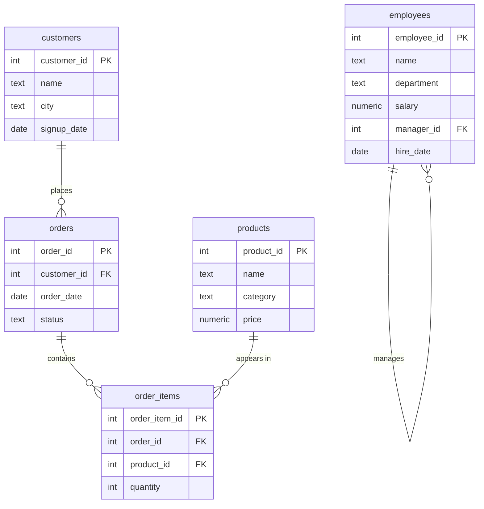
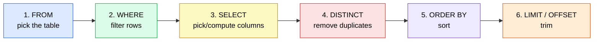

# Chapter 1: Foundations

**You will learn:** what a database is, data types, reading and filtering rows, sorting, removing duplicates, and how to handle `NULL`.

## Contents
0. [Setup](#0-setup)
1. [What is a database?](#1-what-is-a-database)
2. [Data types](#2-data-types)
3. [SELECT and FROM](#3-select-and-from)
4. [WHERE: filtering rows](#4-where-filtering-rows)
5. [AND, OR, NOT](#5-and-or-not)
6. [IN and BETWEEN](#6-in-and-between)
7. [LIKE and ILIKE](#7-like-and-ilike)
8. [ORDER BY, LIMIT, OFFSET](#8-order-by-limit-offset)
9. [DISTINCT](#9-distinct)
10. [NULL](#10-null)
11. [The order Postgres runs your query](#11-the-order-postgres-runs-your-query)
12. [Chapter 1 cheat sheet](#12-day-1-cheat-sheet)
13. [Practice problems](#13-practice-problems)
14. [Solutions](#14-solutions)

[← Back to table of contents](../README.md) · SQL files for this chapter: [`schema.sql`](../sql/schema.sql), [`chapter-01-examples.sql`](../sql/chapter-01-examples.sql), [`chapter-01-solutions.sql`](../sql/chapter-01-solutions.sql)

---

## 0. Setup

1. Install PostgreSQL (postgresql.org) plus a client: pgAdmin (bundled), DBeaver, or `psql`. No install? Use an online sandbox such as db-fiddle.com.
2. Create a database and connect to it:

```sql
CREATE DATABASE shop;
```

3. Run this script once. It builds five small tables and fills them with data.

<details>
<summary><b>Click to expand: practice database script</b></summary>

```sql
DROP TABLE IF EXISTS order_items, orders, products, customers, employees CASCADE;

CREATE TABLE customers (
    customer_id  SERIAL PRIMARY KEY,
    name         TEXT NOT NULL,
    city         TEXT,
    signup_date  DATE
);

CREATE TABLE products (
    product_id  SERIAL PRIMARY KEY,
    name        TEXT NOT NULL,
    category    TEXT,
    price       NUMERIC(10,2)
);

CREATE TABLE orders (
    order_id     SERIAL PRIMARY KEY,
    customer_id  INT REFERENCES customers(customer_id),
    order_date   DATE,
    status       TEXT
);

CREATE TABLE order_items (
    order_item_id  SERIAL PRIMARY KEY,
    order_id       INT REFERENCES orders(order_id),
    product_id     INT REFERENCES products(product_id),
    quantity       INT
);

CREATE TABLE employees (
    employee_id  SERIAL PRIMARY KEY,
    name         TEXT NOT NULL,
    department   TEXT,
    salary       NUMERIC(10,2),
    manager_id   INT REFERENCES employees(employee_id),
    hire_date    DATE
);

INSERT INTO customers (name, city, signup_date) VALUES
('Asha',   'Mumbai',    '2024-01-15'),
('Ben',    'Delhi',     '2024-02-20'),
('Chitra', 'Mumbai',    '2024-03-05'),
('Dev',    NULL,        '2024-03-18'),
('Esha',   'Bengaluru', '2024-04-02'),
('Farhan', 'Delhi',     '2024-05-11');

INSERT INTO products (name, category, price) VALUES
('Laptop',     'Electronics', 55000.00),
('Phone',      'Electronics', 30000.00),
('Headphones', 'Electronics',  2500.00),
('Notebook',   'Stationery',     60.00),
('Pen',        'Stationery',     10.00),
('Desk Lamp',  'Home',         1200.00);

INSERT INTO orders (customer_id, order_date, status) VALUES
(1, '2024-05-01', 'delivered'),
(1, '2024-06-10', 'delivered'),
(2, '2024-06-12', 'cancelled'),
(3, '2024-06-15', 'delivered'),
(4, '2024-07-01', 'pending'),
(5, '2024-07-04', 'delivered'),
(3, '2024-07-20', 'delivered');

INSERT INTO order_items (order_id, product_id, quantity) VALUES
(1, 1, 1), (1, 3, 2),
(2, 4, 10), (2, 5, 20),
(3, 2, 1),
(4, 6, 2),
(5, 3, 1),
(6, 2, 1), (6, 3, 1),
(7, 1, 1), (7, 4, 5);

INSERT INTO employees (name, department, salary, manager_id, hire_date) VALUES
('Rohan',  'Management',  150000, NULL, '2018-01-10'),
('Meera',  'Engineering', 120000, 1,    '2019-03-15'),
('Karan',  'Engineering',  90000, 2,    '2020-07-01'),
('Sneha',  'Engineering',  90000, 2,    '2021-02-20'),
('Imran',  'Sales',        70000, 1,    '2020-11-05'),
('Priya',  'Sales',        65000, 5,    '2022-01-17'),
('Tanvi',  'HR',           60000, 1,    '2021-09-09');
```

</details>

4. Check it worked. This should return **6 rows**:

```sql
SELECT * FROM customers;
```

### The map of our practice database



Read `||--o{` as "one to many": one customer places many orders. Today we only use one table at a time. Linking tables is Chapter 3.

**Deliberate quirks in the data** (we'll use them to learn):
- Dev has **no city** (a `NULL`)
- Farhan **never ordered** anything
- Karan and Sneha **tie** on salary

---

## 1. What is a database?

A database is a folder of Excel sheets that can reference each other.

```
 DATABASE: shop
 ┌──────────────────────────────────────────────────────────────┐
 │                                                              │
 │   TABLE: customers  (one "sheet")                            │
 │   ┌─────────────┬────────┬───────────┬─────────────┐         │
 │   │ customer_id │ name   │ city      │ signup_date │ ◄─ COLUMNS (attributes)
 │   ├─────────────┼────────┼───────────┼─────────────┤         │
 │   │ 1           │ Asha   │ Mumbai    │ 2024-01-15  │ ◄─ ROW (one record)
 │   │ 2           │ Ben    │ Delhi     │ 2024-02-20  │         │
 │   │ 3           │ Chitra │ Mumbai    │ 2024-03-05  │         │
 │   └─────────────┴────────┴───────────┴─────────────┘         │
 │                                                              │
 │   + products, orders, order_items, employees ...             │
 └──────────────────────────────────────────────────────────────┘
```

| Term | Excel equivalent | Meaning |
|---|---|---|
| Table | Sheet | A collection of one kind of thing (customers) |
| Row | A line | One record (one customer) |
| Column | A heading | One attribute (city) |
| Primary key | A unique ID | Identifies each row uniquely (`customer_id`) |

**SQL describes what you want, not how to get it.** You say "customers in Mumbai" and Postgres works out the steps. That is why SQL is called a *declarative* language.

---

## 2. Data types

Every column has a type. The type controls what you can store and what operations work.

```
                       DATA TYPES
        ┌───────────────────┼───────────────────┐
     NUMBERS              TEXT            DATE / TIME  +  LOGIC
   ┌────┴─────┐             │             ┌─────┴─────┐      │
  INT     NUMERIC         TEXT         DATE   TIMESTAMP   BOOLEAN
 (whole)  (exact       (any length,   (day)  (day + time) (true/false)
          decimals)     VARCHAR(n)
                        caps length)
```

| Type | Stores | Example |
|---|---|---|
| `INT` | whole numbers | `42` (`BIGINT` for huge ones) |
| `NUMERIC(10,2)` | exact decimals: 10 digits total, 2 after the point | `55000.00` |
| `TEXT` | text of any length | `'Mumbai'` |
| `DATE` | a calendar day | `'2024-01-15'` |
| `TIMESTAMP` | date and time (`TIMESTAMPTZ` adds time zone) | `'2024-01-15 10:30:00'` |
| `BOOLEAN` | true or false | `TRUE` |
| `SERIAL` | an auto-counting integer: 1, 2, 3... | used for IDs |

**Why `NUMERIC` for money, not `FLOAT`?** Floats are approximate. Try it:

```sql
SELECT 0.1::float8 + 0.2::float8 AS float_sum,
       0.1::numeric + 0.2::numeric AS numeric_sum;
```

| float_sum | numeric_sum |
|---|---|
| 0.30000000000000004 | 0.3 |

**Quotes matter**

```
 'Mumbai'   single quotes  ->  a VALUE (text)
 "city"     double quotes  ->  a NAME (column/table identifier)
```

---

## 3. SELECT and FROM

**Idea:** `SELECT` chooses **columns**. `FROM` says **which table**.

```
   SELECT name, city        <- which columns to show
   FROM   customers;        <- from which table

   customers                                   result
   ┌────┬────────┬───────────┬──────┐         ┌────────┬───────────┐
   │ id │ name   │ city      │ date │  ───►   │ name   │ city      │
   ├────┼────────┼───────────┼──────┤         ├────────┼───────────┤
   │ 1  │ Asha   │ Mumbai    │ ...  │         │ Asha   │ Mumbai    │
   │ 2  │ Ben    │ Delhi     │ ...  │         │ Ben    │ Delhi     │
   └────┴────────┴───────────┴──────┘         └────────┴───────────┘
        (picks vertical slices: COLUMNS)
```

```sql
SELECT name, city FROM customers;     -- two columns
SELECT * FROM customers;              -- every column (* = "all")
```

Use `*` for exploring. In real code, name the columns: it's faster, clearer, and doesn't break when the table changes.

### Aliases: renaming output columns

```sql
SELECT name AS product_name, price AS price_inr FROM products;
```

### Calculated columns

```sql
SELECT name, price, price * 0.18 AS gst FROM products;
```

### SELECT with no table

```sql
SELECT 2 + 3 AS result, NOW() AS right_now;
```

### Break it on purpose

```sql
SELECT nam FROM customers;     -- ERROR: column "nam" does not exist
SELECT name FROM customer;     -- ERROR: relation "customer" does not exist
```

Postgres errors tell you exactly what they couldn't find. Read them.

---

## 4. WHERE: filtering rows

**Idea:** `SELECT` picks columns. `WHERE` picks rows. Think of a **bouncer**: every row walks up and only rows that satisfy the condition get in.

```
   ALL ROWS                 WHERE city = 'Mumbai'               RESULT
  ┌──────────────┐        ┌────────────────────┐          ┌──────────────┐
  │ Asha  Mumbai │ ─────► │ ✔ city = 'Mumbai'  │ ───────► │ Asha  Mumbai │
  │ Ben   Delhi  │ ─────► │ ✘ rejected         │          │ Chitra Mumbai│
  │ Chitra Mumbai│ ─────► │ ✔                  │          └──────────────┘
  │ Dev   NULL   │ ─────► │ ✘ (unknown = out)  │
  │ Esha  Bengal.│ ─────► │ ✘                  │
  └──────────────┘        └────────────────────┘
        (picks horizontal slices: ROWS)
```

```sql
SELECT * FROM customers WHERE city = 'Mumbai';
```

**Comparison operators**

| Operator | Meaning |
|---|---|
| `=` | equal (one `=`, not `==`) |
| `<>` or `!=` | not equal |
| `<` `>` `<=` `>=` | less / greater (or equal) |

```sql
SELECT name, price FROM products WHERE price > 1000;
SELECT * FROM orders WHERE status <> 'delivered';
SELECT * FROM customers WHERE signup_date >= '2024-03-01';
```

> Text comparison is **case-sensitive**: `'mumbai'` is not equal to `'Mumbai'`.

---

## 5. AND, OR, NOT

```
   A AND B   ->  both must be true      (narrows the result)
   A OR  B   ->  at least one is true   (widens the result)
   NOT A     ->  flips true and false
```

```sql
SELECT * FROM products WHERE category = 'Electronics' AND price < 5000;
SELECT * FROM customers WHERE city = 'Mumbai' OR city = 'Delhi';
SELECT * FROM orders WHERE NOT status = 'delivered';
```

### Precedence: `AND` binds tighter than `OR`

Like multiplication before addition in maths: `2 + 3 * 4` is `14`, not `20`.

```sql
SELECT name, category, price FROM products
WHERE category = 'Stationery' OR category = 'Home' AND price > 1000;
```

```
 Postgres reads it as:

   category = 'Stationery'   OR   ( category = 'Home'  AND  price > 1000 )
   └────── part 1 ───────┘        └──────────── part 2 (groups first) ─────────┘

 Result:  Notebook, Pen (all Stationery)  +  Desk Lamp (Home and > 1000)
```

Now add parentheses to change the meaning:

```sql
SELECT name, category, price FROM products
WHERE (category = 'Stationery' OR category = 'Home') AND price > 1000;
```

```
   ( Stationery  OR  Home )  AND  price > 1000
   └──── group first ────┘

 Result:  Desk Lamp only  (Notebook and Pen cost less than 1000)
```

> **Rule:** whenever you mix `AND` and `OR`, use parentheses. They cost nothing and remove doubt.

---

## 6. IN and BETWEEN

### IN: a shortcut for many ORs

```sql
-- Long way
SELECT * FROM customers WHERE city = 'Mumbai' OR city = 'Delhi' OR city = 'Bengaluru';

-- Short way (same result)
SELECT * FROM customers WHERE city IN ('Mumbai', 'Delhi', 'Bengaluru');

-- Opposite
SELECT * FROM customers WHERE city NOT IN ('Mumbai', 'Delhi');
```

### BETWEEN: a range, inclusive on both ends

```sql
SELECT name, price FROM products WHERE price BETWEEN 50 AND 2500;
```

```
 price:   10      50     60        1200      2500      30000     55000
 ──────────┼───────┼──────┼──────────┼─────────┼──────────┼─────────┼───►
         Pen     [50 ──────── BETWEEN 50 AND 2500 ───────── 2500]
                       Notebook   Desk Lamp   Headphones
                                              ▲
                               2500 is INCLUDED (both ends count)
```

`BETWEEN 50 AND 2500` is exactly `price >= 50 AND price <= 2500`.

> **Date trap:** for `TIMESTAMP` columns, `BETWEEN '2024-03-01' AND '2024-03-31'` stops at *midnight* of March 31, missing the rest of that day. Safer: `>= '2024-03-01' AND < '2024-04-01'`.

---

## 7. LIKE and ILIKE

Pattern matching for text.

```
   %   matches ANY number of characters (even zero)
   _   matches EXACTLY one character
```

| Pattern | Meaning | Matches in `customers.name` |
|---|---|---|
| `'A%'` | starts with A | Asha |
| `'%a'` | ends with a | Asha, Chitra, Esha |
| `'%ha%'` | contains "ha" | Asha, Esha, Farhan |
| `'_en'` | 3 letters, ends in "en" | Ben |

```sql
SELECT name FROM customers WHERE name LIKE 'A%';
SELECT name FROM customers WHERE name LIKE '%a';
SELECT name FROM customers WHERE name LIKE '%ha%';
SELECT name FROM customers WHERE name LIKE '_en';
```

**Case:** `LIKE` is case-sensitive. `ILIKE` ignores case (the "I" stands for insensitive, and it's Postgres-specific).

```sql
SELECT name FROM customers WHERE name LIKE  'a%';   -- 0 rows: no name starts with lowercase a
SELECT name FROM customers WHERE name ILIKE 'a%';   -- Asha
```

---

## 8. ORDER BY, LIMIT, OFFSET

### Sorting

```sql
SELECT name, price FROM products ORDER BY price;        -- low to high (ASC is the default)
SELECT name, price FROM products ORDER BY price DESC;   -- high to low
SELECT name, category, price FROM products ORDER BY category, price DESC;
```

The last query sorts by category first, then by price *inside* each category.

### LIMIT and OFFSET

`LIMIT n` = take n rows. `OFFSET m` = skip m rows first.

```sql
SELECT name, price FROM products ORDER BY price DESC LIMIT 3;
SELECT name, price FROM products ORDER BY price DESC LIMIT 3 OFFSET 3;
```

```
 Sorted by price DESC:
   rank 1  Laptop      55000 ─┐
   rank 2  Phone       30000  ├─ LIMIT 3             (first query)
   rank 3  Headphones   2500 ─┘
   rank 4  Desk Lamp    1200 ─┐
   rank 5  Notebook       60  ├─ LIMIT 3 OFFSET 3    (second query: skip 3, take 3)
   rank 6  Pen            10 ─┘
```

This is how websites build page 1, page 2, page 3.

### Two traps

1. **`LIMIT` without `ORDER BY` returns arbitrary rows.** A table has no built-in order. "Top 3" always needs `ORDER BY`.
2. **Ties need a tie-breaker.** Karan and Sneha both earn 90000, so `ORDER BY salary DESC` alone may order them either way. Add a second column: `ORDER BY salary DESC, name`.

### Where do NULLs go when sorting?

```
 ASC  (default):   Bengaluru, Delhi, Delhi, Mumbai, Mumbai, NULL   <- NULL last
 DESC:             NULL, Mumbai, Mumbai, Delhi, Delhi, Bengaluru   <- NULL first
```

Override it:

```sql
SELECT name, city FROM customers ORDER BY city NULLS FIRST;
```

---

## 9. DISTINCT

Removes duplicate rows from the output.

```
   SELECT city FROM customers;           SELECT DISTINCT city FROM customers;
   ┌───────────┐                          ┌───────────┐
   │ Mumbai    │                          │ Mumbai    │
   │ Delhi     │                          │ Delhi     │
   │ Mumbai    │ ◄─ duplicate, dropped    │ NULL      │
   │ NULL      │                          │ Bengaluru │
   │ Bengaluru │                          └───────────┘
   │ Delhi     │ ◄─ duplicate, dropped        4 rows
   └───────────┘
       6 rows
```

```sql
SELECT DISTINCT city FROM customers;
SELECT DISTINCT department FROM employees;
SELECT DISTINCT category, price > 1000 AS is_premium FROM products;
```

`DISTINCT` looks at the **whole row** of the columns you selected. `SELECT DISTINCT city, name` is *not* "unique cities": it's unique (city, name) pairs.

Note that `DISTINCT` treats all NULLs as the same, so only one NULL appears.

---

## 10. NULL

> **NULL means "unknown" or "missing". It is not zero. It is not an empty string.**

**Analogy:** a sealed envelope. You don't know what's inside, so you can't say it equals anything, not even another sealed envelope.

```
   0     = a known number (zero)
   ''    = known text that happens to be empty
   NULL  = "I don't know what's here"   ✉
```

### 10.1 Comparisons with NULL are never true or false: they're UNKNOWN

```
   city = 'Mumbai'    ->  TRUE or FALSE for known cities
   NULL = 'Mumbai'    ->  UNKNOWN
   NULL = NULL        ->  UNKNOWN   (two unknown things: can't say they're equal)
   NULL <> 'Mumbai'   ->  UNKNOWN
```

And `WHERE` only keeps rows where the condition is **TRUE**:

```
   TRUE     ──►  row kept
   FALSE    ──►  row dropped
   UNKNOWN  ──►  row dropped  (this is the surprise!)
```

So to test for NULL, use `IS NULL`:

```sql
SELECT * FROM customers WHERE city = NULL;       -- 0 rows. Always. A classic bug.
SELECT * FROM customers WHERE city IS NULL;      -- Dev
SELECT * FROM customers WHERE city IS NOT NULL;  -- the other 5
```

### 10.2 NULLs vanish from "not equal" filters

```sql
SELECT name FROM customers WHERE city <> 'Mumbai';
```

```
   customer   city        city <> 'Mumbai'   kept?
   ─────────  ──────────  ─────────────────  ──────
   Asha       Mumbai      FALSE              ✘
   Ben        Delhi       TRUE               ✔
   Chitra     Mumbai      FALSE              ✘
   Dev        NULL        UNKNOWN            ✘  ◄─ silently lost!
   Esha       Bengaluru   TRUE               ✔
   Farhan     Delhi       TRUE               ✔
```

You may have expected Dev. Two fixes:

```sql
SELECT name FROM customers WHERE city <> 'Mumbai' OR city IS NULL;
SELECT name FROM customers WHERE city IS DISTINCT FROM 'Mumbai';   -- Postgres: NULL-safe "not equal"
```

### 10.3 Arithmetic and text with NULL give NULL

```sql
SELECT 5 + NULL;            -- NULL
SELECT 'Hello ' || NULL;    -- NULL  (|| joins text)
```

NULL is contagious: any calculation that touches it becomes NULL.

### 10.4 Three-valued logic

SQL has three truth values: TRUE, FALSE, UNKNOWN (shown here as NULL).

```
   AND  │ TRUE   FALSE  NULL         OR   │ TRUE   FALSE  NULL
  ──────┼─────────────────────      ──────┼─────────────────────
  TRUE  │ TRUE   FALSE  NULL        TRUE  │ TRUE   TRUE   TRUE
  FALSE │ FALSE  FALSE  FALSE       FALSE │ TRUE   FALSE  NULL
  NULL  │ NULL   FALSE  NULL        NULL  │ TRUE   NULL   NULL

   NOT TRUE = FALSE     NOT FALSE = TRUE     NOT NULL = NULL
```

How to remember: `FALSE AND anything` is FALSE (it can't be rescued), and `TRUE OR anything` is TRUE (it's already satisfied). Otherwise the unknown stays unknown.

### 10.5 Handy NULL tools

```sql
SELECT name, COALESCE(city, 'Unknown') AS city FROM customers;   -- first non-NULL value
SELECT NULLIF(0, 0);                                             -- NULL if both are equal, else the first
```

```
   COALESCE(city, 'Unknown')
      city = 'Mumbai'  ──►  'Mumbai'     (has a value, use it)
      city = NULL      ──►  'Unknown'    (missing, use the fallback)
```

### 10.6 Preview: aggregates skip NULLs (full detail on Chapter 2)

```sql
SELECT COUNT(*) AS all_rows, COUNT(city) AS rows_with_city FROM customers;
```

| all_rows | rows_with_city |
|---|---|
| 6 | 5 |

`COUNT(*)` counts rows. `COUNT(column)` counts non-NULL values.

### 10.7 Preview: the NOT IN trap (full detail on Chapter 4)

```sql
SELECT 1 WHERE 1 NOT IN (2, 3);         -- returns a row
SELECT 1 WHERE 1 NOT IN (2, 3, NULL);   -- returns nothing!
```

```
   1 NOT IN (2, 3, NULL)
   =  (1 <> 2)  AND  (1 <> 3)  AND  (1 <> NULL)
        TRUE         TRUE            UNKNOWN
   =  TRUE AND TRUE AND UNKNOWN  =  UNKNOWN   ──►  row dropped
```

One NULL in the list poisons the entire `NOT IN`.

---

## 11. The order Postgres runs your query

You *write* `SELECT` first, but Postgres *runs* it in a different order:



(Chapter 2 adds `GROUP BY` and `HAVING`, which slot in right after `WHERE`.)

**Why this matters:** each step can only use things created in earlier steps.

```sql
SELECT price * 0.18 AS gst FROM products WHERE gst > 100;           -- ERROR: gst doesn't exist yet at WHERE
SELECT price * 0.18 AS gst FROM products WHERE price * 0.18 > 100;  -- OK
SELECT price * 0.18 AS gst FROM products ORDER BY gst;              -- OK: ORDER BY runs after SELECT
```

```
   WHERE runs here ─┐         alias "gst" is born here ─┐
                    ▼                                    ▼
   FROM ──► WHERE ──► SELECT ──► DISTINCT ──► ORDER BY ──► LIMIT
                       ✘ can't see "gst"        ✔ can see "gst"
```

---

## 12. Chapter 1 cheat sheet

```sql
SELECT   col1, col2 AS alias      -- which columns
FROM     table_name               -- which table
WHERE    condition                -- which rows
ORDER BY col DESC                 -- in what order
LIMIT    n OFFSET m;              -- how many, after skipping how many
```

| I want to... | Use |
|---|---|
| Match any of several values | `IN ('a','b')` |
| Match a range (inclusive) | `BETWEEN a AND b` |
| Match a text pattern | `LIKE` / `ILIKE` with `%` and `_` |
| Find missing values | `IS NULL` / `IS NOT NULL` |
| NULL-safe "not equal" | `IS DISTINCT FROM` |
| Replace NULL with a default | `COALESCE(col, default)` |
| Remove duplicate rows | `DISTINCT` |
| Get the top N | `ORDER BY ... DESC LIMIT N` (add a tie-breaker) |

**Five things to never forget**
1. Text uses `'single quotes'` and is case-sensitive.
2. `AND` is evaluated before `OR`. Use parentheses.
3. `= NULL` never works. Use `IS NULL`.
4. `<>` and `NOT IN` silently drop NULL rows.
5. `LIMIT` without `ORDER BY` is random.

---

## 13. Practice problems

Type each query yourself. Say it in English first. Check the solution only after you've tried.

### Easy
1. Show the `name` and `price` of all products.
2. Show all customers who live in Mumbai.
3. Show products that cost more than 1000.
4. Show Electronics products that cost less than 5000.
5. Show customers living in Mumbai or Delhi (use `IN`).
6. Show products priced between 50 and 2500 (inclusive).
7. Show customers whose name starts with `A`.
8. Show customers whose name contains the letter `a`, ignoring case.
9. Show customers with no city recorded.

### Medium
10. Show the 3 most expensive products (name and price).
11. List the distinct cities in `customers`. How many rows come back, and why?
12. List the distinct departments in `employees`.
13. Show orders that are **not** delivered.
14. Show the employee who has no manager.
15. Show customers who signed up in March 2024.
16. Show products with a column `price_with_gst` (price plus 18%), sorted highest to lowest.
17. Show each customer with their city, replacing a missing city with `'Unknown'`.

### Challenging (these use the traps)
18. Show customers **not** in Mumbai, **including** those with no city. Write it two ways.
19. Show employees ranked 2nd to 4th by salary. Make the order deterministic even with ties.
20. Write a query returning Stationery products plus Home products above 1000. Then write one returning products above 1000 that are in either category. Explain the difference.
21. Predict the output first, then run to check:
    ```sql
    SELECT 1 WHERE NULL = NULL;
    SELECT 1 WHERE NULL IS NULL;
    SELECT 1 WHERE 5 NOT IN (1, 2, NULL);
    SELECT COUNT(*), COUNT(city) FROM customers;
    ```

**Self-check: you've mastered Chapter 1 when you can explain, without notes:**
- why `= NULL` fails,
- how `AND` and `OR` are grouped,
- why `LIMIT` needs `ORDER BY`,
- what `<>` does to NULL rows.

---

## 14. Solutions

<details>
<summary><b>Click to reveal (try first!)</b></summary>

```sql
-- 1
SELECT name, price FROM products;

-- 2
SELECT * FROM customers WHERE city = 'Mumbai';                      -- Asha, Chitra

-- 3
SELECT * FROM products WHERE price > 1000;                          -- Laptop, Phone, Headphones, Desk Lamp

-- 4
SELECT * FROM products WHERE category = 'Electronics' AND price < 5000;   -- Headphones

-- 5
SELECT * FROM customers WHERE city IN ('Mumbai', 'Delhi');          -- Asha, Ben, Chitra, Farhan

-- 6
SELECT name, price FROM products WHERE price BETWEEN 50 AND 2500;   -- Headphones, Notebook, Desk Lamp

-- 7
SELECT * FROM customers WHERE name LIKE 'A%';                       -- Asha

-- 8
SELECT * FROM customers WHERE name ILIKE '%a%';                     -- Asha, Chitra, Esha, Farhan

-- 9
SELECT * FROM customers WHERE city IS NULL;                         -- Dev

-- 10
SELECT name, price FROM products ORDER BY price DESC LIMIT 3;       -- Laptop, Phone, Headphones

-- 11
SELECT DISTINCT city FROM customers;
-- 4 rows: Mumbai, Delhi, Bengaluru and NULL. DISTINCT keeps one NULL rather than removing it.

-- 12
SELECT DISTINCT department FROM employees;                          -- 4 rows

-- 13
SELECT * FROM orders WHERE status <> 'delivered';                   -- order 3 (cancelled), order 5 (pending)

-- 14
SELECT * FROM employees WHERE manager_id IS NULL;                   -- Rohan

-- 15
SELECT * FROM customers
WHERE signup_date >= '2024-03-01' AND signup_date < '2024-04-01';   -- Chitra, Dev

-- 16
SELECT name, price, price * 1.18 AS price_with_gst
FROM products
ORDER BY price_with_gst DESC;

-- 17
SELECT name, COALESCE(city, 'Unknown') AS city FROM customers;

-- 18 (two ways)
SELECT name FROM customers WHERE city <> 'Mumbai' OR city IS NULL;
SELECT name FROM customers WHERE city IS DISTINCT FROM 'Mumbai';    -- Ben, Dev, Esha, Farhan

-- 19
SELECT name, salary FROM employees
ORDER BY salary DESC, name
LIMIT 3 OFFSET 1;                                                   -- Meera, Karan, Sneha

-- 20
SELECT name, category, price FROM products
WHERE category = 'Stationery' OR (category = 'Home' AND price > 1000);   -- Notebook, Pen, Desk Lamp

SELECT name, category, price FROM products
WHERE category IN ('Stationery', 'Home') AND price > 1000;               -- Desk Lamp only
-- The first lets ALL Stationery through. The second applies the price filter to both categories.

-- 21
SELECT 1 WHERE NULL = NULL;             -- 0 rows (UNKNOWN is not TRUE)
SELECT 1 WHERE NULL IS NULL;            -- 1 row
SELECT 1 WHERE 5 NOT IN (1, 2, NULL);   -- 0 rows (the NOT IN + NULL trap)
SELECT COUNT(*), COUNT(city) FROM customers;   -- 6 and 5
```

</details>

---

*End of Chapter 1.*

**Next:** Chapter 2: Shaping Data (GROUP BY, aggregates, functions, CASE WHEN).
