# Chapter 2: Shaping Data

**You will learn:** how to summarize many rows into answers (totals, averages, counts), group rows into buckets, filter those buckets, transform text, numbers and dates, and make decisions inside a query with `CASE`.

**Before you start:** you should be comfortable with Chapter 1 (`SELECT`, `WHERE`, `ORDER BY`, `NULL`). Make sure the practice database from `sql/schema.sql` is loaded.

## Contents
1. [Aggregate functions](#1-aggregate-functions)
2. [GROUP BY](#2-group-by)
3. [HAVING: filtering groups](#3-having-filtering-groups)
4. [The full order Postgres runs your query](#4-the-full-order-postgres-runs-your-query)
5. [String functions](#5-string-functions)
6. [Numeric functions](#6-numeric-functions)
7. [Date and time functions](#7-date-and-time-functions)
8. [CASE WHEN: if/else inside SQL](#8-case-when-ifelse-inside-sql)
9. [Casting: converting types](#9-casting-converting-types)
10. [Chapter 2 cheat sheet](#10-chapter-2-cheat-sheet)
11. [Practice problems](#11-practice-problems)
12. [Solutions](#12-solutions)

[← Back to table of contents](../README.md) · SQL files: [`chapter-02-examples.sql`](../sql/chapter-02-examples.sql), [`chapter-02-solutions.sql`](../sql/chapter-02-solutions.sql)

---

## 1. Aggregate functions

**Idea:** an aggregate function takes **many rows** and squeezes them into **one value**.

```
   many rows                                   one answer
  ┌─────────┐
  │   10    │
  │   60    │                ┌───────┐
  │  1200   │   ────────►    │  SUM  │   ────────►   88770
  │  2500   │                └───────┘
  │ 30000   │
  │ 55000   │
  └─────────┘
```

The five you'll use constantly:

| Function | Returns |
|---|---|
| `COUNT(*)` | number of rows |
| `SUM(col)` | total |
| `AVG(col)` | average |
| `MIN(col)` | smallest |
| `MAX(col)` | largest |

```sql
SELECT COUNT(*)   AS how_many,
       SUM(price) AS total,
       AVG(price) AS average,
       MIN(price) AS cheapest,
       MAX(price) AS priciest
FROM products;
```

| how_many | total | average | cheapest | priciest |
|---|---|---|---|---|
| 6 | 88770.00 | 14795.00 | 10.00 | 55000.00 |

You can combine aggregates with `WHERE`. The filter runs **first**, then the aggregate sees only the surviving rows:

```sql
SELECT COUNT(*), AVG(price) FROM products WHERE category = 'Electronics';
```

### Three kinds of COUNT

```sql
SELECT COUNT(*)            AS all_rows,
       COUNT(city)         AS rows_with_city,
       COUNT(DISTINCT city) AS different_cities
FROM customers;
```

| all_rows | rows_with_city | different_cities |
|---|---|---|
| 6 | 5 | 3 |

```
   customers.city:   Mumbai, Delhi, Mumbai, NULL, Bengaluru, Delhi

   COUNT(*)              counts every row                      -> 6
   COUNT(city)           counts rows where city is NOT NULL    -> 5
   COUNT(DISTINCT city)  counts unique non-NULL values         -> 3  (Mumbai, Delhi, Bengaluru)
```

### Aggregates ignore NULL

(This follows from Chapter 1's rule that NULL means "unknown".)

```sql
SELECT AVG(x) FROM (VALUES (10), (20), (NULL)) AS t(x);
```

The answer is **15**, not 10. The NULL is skipped entirely: the average is (10 + 20) / 2, not (10 + 20 + 0) / 3. If you want NULL treated as zero, say so: `AVG(COALESCE(x, 0))`.

### Aggregating zero rows

```sql
SELECT SUM(price) AS total, COUNT(*) AS n FROM products WHERE price > 999999;
```

| total | n |
|---|---|
| NULL | 0 |

`COUNT` of nothing is `0`, but `SUM`, `AVG`, `MIN` and `MAX` of nothing are `NULL`. If you need a `0`, write `COALESCE(SUM(price), 0)`.

### Break it on purpose: mixing aggregates with normal columns

```sql
SELECT name, COUNT(*) FROM customers;
-- ERROR: column "customers.name" must appear in the GROUP BY clause or be used in an aggregate function
```

The aggregate produces **one** row, but `name` has six values. Postgres can't pick one for you. This leads straight into the next section.

---

## 2. GROUP BY

**Idea:** instead of one answer for the whole table, get **one answer per group**.

**Analogy:** sorting laundry. First you pile clothes by colour (`GROUP BY`), then you count or weigh each pile (aggregate).

```
   products                                 GROUP BY category                 COUNT(*), AVG(price)
  ┌────────────┬─────────────┬───────┐     ┌──────────────────────────┐      ┌─────────────┬───┬───────┐
  │ Laptop     │ Electronics │ 55000 │ ──► │ Electronics pile         │ ──►  │ Electronics │ 3 │ 29167 │
  │ Phone      │ Electronics │ 30000 │ ──► │   Laptop, Phone,         │      ├─────────────┼───┼───────┤
  │ Headphones │ Electronics │  2500 │ ──► │   Headphones             │      │ Stationery  │ 2 │    35 │
  │ Notebook   │ Stationery  │    60 │ ──► ├──────────────────────────┤      ├─────────────┼───┼───────┤
  │ Pen        │ Stationery  │    10 │ ──► │ Stationery pile          │      │ Home        │ 1 │  1200 │
  │ Desk Lamp  │ Home        │  1200 │ ──► │   Notebook, Pen          │      └─────────────┴───┴───────┘
  └────────────┴─────────────┴───────┘     ├──────────────────────────┤
                                            │ Home pile: Desk Lamp     │      one row PER GROUP
                                            └──────────────────────────┘
```

```sql
SELECT category, COUNT(*) AS products, AVG(price) AS avg_price
FROM products
GROUP BY category;
```

More examples:

```sql
SELECT department, COUNT(*) AS headcount, AVG(salary) AS avg_salary
FROM employees
GROUP BY department;

SELECT status, COUNT(*) AS orders
FROM orders
GROUP BY status
ORDER BY orders DESC;
```

### The golden rule of GROUP BY

> Every column in `SELECT` must either be **in the `GROUP BY`** or be **inside an aggregate function**.

```sql
SELECT department, name, AVG(salary) FROM employees GROUP BY department;
-- ERROR: column "employees.name" must appear in the GROUP BY clause or be used in an aggregate function
```

Think about it: a department has several names, so which one should the single result row show? There is no right answer, so Postgres refuses.

### Grouping by more than one column

Each unique **combination** becomes a group:

```sql
SELECT category, price > 1000 AS is_premium, COUNT(*) AS products
FROM products
GROUP BY category, price > 1000;
```

| category | is_premium | products |
|---|---|---|
| Electronics | true | 3 |
| Home | true | 1 |
| Stationery | false | 2 |

### NULL forms its own group

```sql
SELECT city, COUNT(*) FROM customers GROUP BY city;
```

| city | count |
|---|---|
| Bengaluru | 1 |
| Delhi | 2 |
| Mumbai | 2 |
| NULL | 1 |

For `GROUP BY`, all NULLs count as "the same", so they end up together. Make it readable with `COALESCE`:

```sql
SELECT COALESCE(city, 'Unknown') AS city, COUNT(*) AS customers
FROM customers
GROUP BY COALESCE(city, 'Unknown');
```

### Shortcuts (Postgres allows these)

```sql
SELECT department, COUNT(*) AS headcount
FROM employees
GROUP BY 1          -- 1 = the first column in SELECT
ORDER BY headcount DESC;
```

Position numbers and output aliases work in `GROUP BY` and `ORDER BY` in Postgres. They are handy for quick queries; for long-lived code, spelling out the column is clearer.

### WHERE still runs first

```sql
SELECT department, COUNT(*) AS headcount
FROM employees
WHERE salary > 60000
GROUP BY department;
```

`WHERE` removes Tanvi (60000) *before* any grouping happens, so HR disappears from the output.

---

## 3. HAVING: filtering groups

**Problem:** show only departments whose average salary exceeds 80000. You can't use `WHERE`, because the average doesn't exist until the groups are formed.

```sql
SELECT department FROM employees WHERE AVG(salary) > 80000 GROUP BY department;
-- ERROR: aggregate functions are not allowed in WHERE
```

**Solution:** `HAVING` filters **groups** after they've been built.

```sql
SELECT department, AVG(salary) AS avg_salary
FROM employees
GROUP BY department
HAVING AVG(salary) > 80000;
```

| department | avg_salary |
|---|---|
| Engineering | 100000 |
| Management | 150000 |

```
                WHERE                                   HAVING
        (filters individual ROWS)               (filters whole GROUPS)

   rows ──► [ keep salary > 60000 ] ──►   groups ──► [ keep AVG(salary) > 80000 ] ──►
            runs BEFORE grouping                      runs AFTER grouping
```

| | `WHERE` | `HAVING` |
|---|---|---|
| Filters | rows | groups |
| Runs | before `GROUP BY` | after `GROUP BY` |
| Can use aggregates? | No | Yes |

More examples:

```sql
-- departments with more than one employee
SELECT department, COUNT(*) AS headcount
FROM employees
GROUP BY department
HAVING COUNT(*) > 1;

-- all three together: filter rows, group, then filter groups
SELECT category, AVG(price) AS avg_price
FROM products
WHERE price > 50
GROUP BY category
HAVING COUNT(*) >= 1
ORDER BY avg_price DESC;
```

> **Rule of thumb:** if the condition is about a single row, use `WHERE` (it's also faster, since it shrinks the data early). If it's about an aggregate, use `HAVING`.

Aliases don't work in `HAVING` either, for the same timing reason as `WHERE`:

```sql
SELECT department, AVG(salary) AS avg_sal FROM employees GROUP BY department HAVING avg_sal > 80000;
-- ERROR: column "avg_sal" does not exist
```

---

## 4. The full order Postgres runs your query

In Chapter 1 you saw part of this. Now we can show the whole thing. You *write* `SELECT` first, but Postgres *runs* it fifth.

```mermaid
flowchart LR
    A["1. FROM<br/>get the table"] --> B["2. WHERE<br/>filter rows"]
    B --> C["3. GROUP BY<br/>form groups"]
    C --> D["4. HAVING<br/>filter groups"]
    D --> E["5. SELECT<br/>compute columns"]
    E --> F["6. DISTINCT<br/>drop duplicates"]
    F --> G["7. ORDER BY<br/>sort"]
    G --> H["8. LIMIT / OFFSET<br/>trim"]
    style A fill:#dbeafe,stroke:#2563eb,color:#000
    style B fill:#dcfce7,stroke:#16a34a,color:#000
    style C fill:#fef9c3,stroke:#ca8a04,color:#000
    style D fill:#fde2e2,stroke:#dc2626,color:#000
    style E fill:#ede9fe,stroke:#7c3aed,color:#000
    style F fill:#ffedd5,stroke:#ea580c,color:#000
    style G fill:#e0f2fe,stroke:#0284c7,color:#000
    style H fill:#f3f4f6,stroke:#6b7280,color:#000
```



**Walk through one query step by step:**

```sql
SELECT department, AVG(salary) AS avg_salary
FROM employees
WHERE hire_date >= '2019-01-01'
GROUP BY department
HAVING COUNT(*) > 1
ORDER BY avg_salary DESC
LIMIT 1;
```

```
 1. FROM     employees                         -> all 7 employees
 2. WHERE    hire_date >= 2019-01-01           -> drops Rohan (hired 2018): 6 left
 3. GROUP BY department                        -> Engineering (3), Sales (2), HR (1)
 4. HAVING   COUNT(*) > 1                      -> drops HR (only 1): Engineering, Sales left
 5. SELECT   department, AVG(salary)           -> Engineering 100000, Sales 67500
 6. (DISTINCT: not used)
 7. ORDER BY avg_salary DESC                   -> Engineering, Sales
 8. LIMIT 1                                    -> Engineering
```

This explains every "why doesn't this work?" so far:

| Mistake | Why it fails |
|---|---|
| Alias in `WHERE` or `HAVING` | Aliases are created at step 5, after those steps |
| Aggregate in `WHERE` | Groups don't exist until step 3 |
| Alias in `ORDER BY` works | `ORDER BY` is step 7, after the alias exists |

---

## 5. String functions

Text manipulation, applied to each row. All of these can be used in `SELECT`, `WHERE`, `GROUP BY` and so on.

| Function | Example | Result |
|---|---|---|
| `UPPER(s)` / `LOWER(s)` | `UPPER('asha')` | `ASHA` |
| `INITCAP(s)` | `INITCAP('hello world')` | `Hello World` |
| `LENGTH(s)` | `LENGTH('Mumbai')` | `6` |
| `TRIM(s)` | `TRIM('  hi  ')` | `hi` |
| `LEFT(s, n)` / `RIGHT(s, n)` | `LEFT('Mumbai', 3)` | `Mum` |
| `SUBSTRING(s FROM a FOR n)` | `SUBSTRING('Postgres' FROM 1 FOR 4)` | `Post` |
| `REPLACE(s, from, to)` | `REPLACE('a-b-c', '-', '/')` | `a/b/c` |
| `POSITION(x IN s)` | `POSITION('a' IN 'Asha')` | `4` (position of first lowercase `a`; positions start at 1) |
| `SPLIT_PART(s, delim, n)` | `SPLIT_PART('x@gmail.com', '@', 2)` | `gmail.com` |

```sql
SELECT UPPER('asha'), LOWER('ASHA'), LENGTH('Mumbai'), TRIM('  hi  '),
       LEFT('Mumbai', 3), RIGHT('Mumbai', 3),
       SUBSTRING('Postgres' FROM 1 FOR 4), REPLACE('a-b-c', '-', '/'),
       POSITION('a' IN 'Asha'), INITCAP('hello world'), SPLIT_PART('x@gmail.com', '@', 2);

SELECT name, UPPER(name) AS shouting, LENGTH(name) AS letters FROM customers;
SELECT name FROM customers WHERE LOWER(name) = 'asha';     -- case-insensitive match
```

### Joining text: `||` vs `CONCAT`

```sql
SELECT name || ' from ' || city          AS with_pipes,
       CONCAT(name, ' from ', city)      AS with_concat,
       CONCAT_WS(', ', name, city)       AS with_separator
FROM customers
WHERE name IN ('Asha', 'Dev');
```

| with_pipes | with_concat | with_separator |
|---|---|---|
| Asha from Mumbai | Asha from Mumbai | Asha, Mumbai |
| NULL | Dev from | Dev |

```
   'Dev' || ' from ' || NULL     ->  NULL            (NULL is contagious)
   CONCAT('Dev', ' from ', NULL) ->  'Dev from '     (CONCAT treats NULL as empty)
   CONCAT_WS(', ', 'Dev', NULL)  ->  'Dev'           (CONCAT_WS skips NULLs, no stray separator)
```

---

## 6. Numeric functions

| Function | Example | Result |
|---|---|---|
| `ROUND(n, d)` | `ROUND(3.14159, 2)` | `3.14` |
| `ROUND(n)` | `ROUND(2.5)` | `3` |
| `ROUND(n, -2)` | `ROUND(132.5, -2)` | `100` (negative digits round to hundreds) |
| `CEIL(n)` | `CEIL(4.2)` | `5` (round up) |
| `FLOOR(n)` | `FLOOR(4.8)` | `4` (round down) |
| `ABS(n)` | `ABS(-5)` | `5` |
| `MOD(a, b)` or `a % b` | `MOD(10, 3)` | `1` (the remainder) |
| `POWER(a, b)` | `POWER(2, 10)` | `1024` |

```sql
SELECT ROUND(3.14159, 2), ROUND(2.5), CEIL(4.2), FLOOR(4.8), ABS(-5), MOD(10, 3), POWER(2, 10);

-- 10% raise, rounded to the nearest 100
SELECT name, salary, ROUND(salary * 1.1, -2) AS new_salary FROM employees;

-- GST with 2 decimals
SELECT name, ROUND(price * 0.18, 2) AS gst FROM products;
```

### The integer division trap

```sql
SELECT 7 / 2 AS int_divide, 7 / 2.0 AS decimal_divide, 7::numeric / 2 AS cast_divide, 7 % 2 AS remainder;
```

| int_divide | decimal_divide | cast_divide | remainder |
|---|---|---|---|
| 3 | 3.5 | 3.5 | 1 |

```
   INT  / INT      ->  INT       7 / 2   = 3     (decimals thrown away!)
   INT  / NUMERIC  ->  NUMERIC   7 / 2.0 = 3.5
```

> **Percentages are the classic victim.** `COUNT(*) / 100` with integers gives a whole number (often 0). Use `COUNT(*) * 100.0 / total` instead.

### ROUND needs NUMERIC when you give it digits

```sql
SELECT ROUND(3.14159::float8, 2);
-- ERROR: function round(double precision, integer) does not exist
SELECT ROUND(3.14159::numeric, 2);     -- works: 3.14
```

`NUMERIC` columns like `price` and `salary` are fine. This only bites if you're working with floating-point values.

---

## 7. Date and time functions

### Today and now

```sql
SELECT CURRENT_DATE AS today, NOW() AS right_now;
```

### Picking a part out of a date: `EXTRACT`

```sql
SELECT EXTRACT(YEAR  FROM DATE '2024-07-20') AS yr,
       EXTRACT(MONTH FROM DATE '2024-07-20') AS mon,
       EXTRACT(DAY   FROM DATE '2024-07-20') AS day,
       EXTRACT(DOW   FROM DATE '2024-07-20') AS weekday;   -- 0 = Sunday ... 6 = Saturday
```

| yr | mon | day | weekday |
|---|---|---|---|
| 2024 | 7 | 20 | 6 |

```sql
-- how many employees were hired each year?
SELECT EXTRACT(YEAR FROM hire_date) AS hire_year, COUNT(*) AS hired
FROM employees
GROUP BY 1
ORDER BY 1;
```

### Snapping a date to the start of a period: `DATE_TRUNC`

`DATE_TRUNC` rounds a date **down** to the start of a month, year, week and so on. It is *the* tool for grouping by month.

```
   DATE_TRUNC('month', 2024-07-20)  ->  2024-07-01
   DATE_TRUNC('year',  2024-07-20)  ->  2024-01-01

   2024-07-01 ──────── 2024-07-20 ───────── 2024-07-31
        ▲                  │
        └──── snaps back ──┘
```

```sql
SELECT DATE_TRUNC('month', order_date)::date AS month, COUNT(*) AS orders
FROM orders
GROUP BY 1
ORDER BY 1;
```

| month | orders |
|---|---|
| 2024-05-01 | 1 |
| 2024-06-01 | 3 |
| 2024-07-01 | 3 |

### Date arithmetic

```sql
SELECT DATE '2024-07-20' - DATE '2024-05-01'   AS days_between,    -- date minus date = number of days
       DATE '2024-01-15' + 30                  AS plus_30_days,    -- date plus integer = date
       DATE '2024-01-15' + INTERVAL '1 month'  AS plus_1_month;    -- date plus interval = timestamp
```

| days_between | plus_30_days | plus_1_month |
|---|---|---|
| 80 | 2024-02-14 | 2024-02-15 00:00:00 |

```
   date  -  date      ->  integer (days)
   date  +  integer   ->  date
   date  +  interval  ->  timestamp
```

### AGE: a human-friendly gap

```sql
SELECT AGE(DATE '2025-01-01', DATE '2024-01-15');     -- 11 mons 17 days

-- full years of service as of 1 Jan 2025
SELECT name, EXTRACT(YEAR FROM AGE(DATE '2025-01-01', hire_date)) AS years_served
FROM employees
ORDER BY hire_date;
```

`AGE(CURRENT_DATE, hire_date)` gives the live version.

### Formatting a date for display: `TO_CHAR`

```sql
SELECT name, TO_CHAR(signup_date, 'DD Mon YYYY') AS joined FROM customers;   -- 15 Jan 2024
```

| Pattern | Meaning |
|---|---|
| `YYYY` | 4-digit year |
| `MM` | month number (01 to 12) |
| `Mon` | short month name (Jan) |
| `Month` | full month name |
| `DD` | day of month |
| `Dy` | short weekday name (Sat) |

---

## 8. CASE WHEN: if/else inside SQL

**Idea:** `CASE` lets a query make decisions, row by row. It checks conditions **top to bottom** and returns the result of the **first one that's true**.

```
   price = 1200
         │
         ▼
   price < 100 ?   ──no──►   price < 5000 ?   ──yes──►   'Mid'   (stop here)
         │                          │
        yes                        no ──► ELSE 'Premium'
         ▼
      'Budget'
```

```sql
SELECT name, price,
       CASE
           WHEN price < 100  THEN 'Budget'
           WHEN price < 5000 THEN 'Mid'
           ELSE 'Premium'
       END AS price_band
FROM products
ORDER BY price;
```

| name | price | price_band |
|---|---|---|
| Pen | 10.00 | Budget |
| Notebook | 60.00 | Budget |
| Desk Lamp | 1200.00 | Mid |
| Headphones | 2500.00 | Mid |
| Phone | 30000.00 | Premium |
| Laptop | 55000.00 | Premium |

Notes:
- Always end with `END`. Name the result with `AS`.
- If no condition matches and there is no `ELSE`, the result is `NULL`.
- Because the first match wins, order your conditions carefully. Put the most specific first.

### CASE with GROUP BY

Group by the label itself:

```sql
SELECT CASE WHEN price < 100 THEN 'Budget'
            WHEN price < 5000 THEN 'Mid'
            ELSE 'Premium' END AS price_band,
       COUNT(*) AS products
FROM products
GROUP BY 1;
```

### CASE inside an aggregate: conditional counting

This is one of the most useful tricks in SQL. It turns rows into columns:

```sql
SELECT SUM(CASE WHEN status = 'delivered' THEN 1 ELSE 0 END) AS delivered,
       SUM(CASE WHEN status <> 'delivered' THEN 1 ELSE 0 END) AS not_delivered
FROM orders;
```

```
   status:      delivered  delivered  cancelled  delivered  pending ...
   CASE → 1/0:      1          1          0          1         0
   SUM  →        adds the 1s  =  count of delivered orders
```

Postgres has a shorter, more readable version for this, `FILTER`:

```sql
SELECT COUNT(*) FILTER (WHERE status = 'delivered')  AS delivered,
       COUNT(*) FILTER (WHERE status <> 'delivered') AS not_delivered
FROM orders;
```

| delivered | not_delivered |
|---|---|
| 5 | 2 |

### COALESCE and NULLIF (a quick recap)

```sql
SELECT COALESCE(city, 'Unknown') FROM customers;     -- first non-NULL value
SELECT 10 / NULLIF(0, 0);                            -- NULLIF turns a 0 into NULL, so no "division by zero" error
```

`NULLIF(a, b)` returns `NULL` when `a = b`, otherwise `a`. It's the standard guard against dividing by zero.

---

## 9. Casting: converting types

**Idea:** sometimes a value has the wrong type for what you want to do. A cast converts it.

Two spellings, same effect:

```sql
SELECT '123'::int + 1;                  -- Postgres shorthand: value::type  -> 124
SELECT CAST('2024-01-15' AS DATE);      -- standard SQL spelling
```

```
   '123'  (text)  ──  ::int  ──►  123  (integer)
   '2024-01-15'   ──  ::date ──►  2024-01-15  (date)
   2500.00        ──  ::int  ──►  2500
   5              ──  ::text ──►  '5'
```

```sql
SELECT '3.7'::numeric,            -- 3.7
       10.5::int,                 -- 11  (rounds to the nearest whole number)
       2500.00::int,              -- 2500
       5::text || 'x';            -- '5x'  (number to text, so || works)
```

Casting is also the cure for integer division:

```sql
SELECT 7::numeric / 2;   -- 3.5
```

### Break it on purpose

```sql
SELECT 'abc'::int;
-- ERROR: invalid input syntax for type integer: "abc"
```

A cast fails when the value can't be converted. That is why clean data matters.

---

## 10. Chapter 2 cheat sheet

```sql
SELECT   column, AGGREGATE(column)      -- 5. what to show
FROM     table                          -- 1. where from
WHERE    row_condition                  -- 2. filter rows
GROUP BY column                         -- 3. make groups
HAVING   aggregate_condition            -- 4. filter groups
ORDER BY column                         -- 7. sort
LIMIT    n;                             -- 8. trim
```

| I want to... | Use |
|---|---|
| Count rows / non-NULL values / unique values | `COUNT(*)` / `COUNT(col)` / `COUNT(DISTINCT col)` |
| One answer per category | `GROUP BY` |
| Filter on an aggregate | `HAVING` |
| Group by month or year | `DATE_TRUNC('month', col)` or `EXTRACT(YEAR FROM col)` |
| Label rows by rules | `CASE WHEN ... THEN ... ELSE ... END` |
| Count only some rows | `COUNT(*) FILTER (WHERE ...)` |
| Replace NULL | `COALESCE(col, default)` |
| Avoid divide-by-zero | `x / NULLIF(y, 0)` |
| Convert type | `value::type` |
| Format a date | `TO_CHAR(date, 'DD Mon YYYY')` |

**Things never to forget**
1. Every `SELECT` column must be in `GROUP BY` or inside an aggregate.
2. `WHERE` filters rows (before grouping). `HAVING` filters groups (after).
3. Aggregates skip NULLs. `COUNT(*)` counts rows, `COUNT(col)` counts non-NULLs.
4. `integer / integer` throws away decimals.
5. Execution order: FROM, WHERE, GROUP BY, HAVING, SELECT, ORDER BY, LIMIT.

---

## 11. Practice problems

Type each query yourself. Say it in English first. Peek at the solutions only after trying.

### Easy
1. How many customers are there?
2. Show the total, average, lowest and highest product price.
3. Show how many products are in each category.
4. Show the average salary in each department.
5. Show how many orders there are for each status.
6. Show the highest and lowest salary among employees.
7. Show each customer's name in uppercase, with the number of letters in it.
8. Show each customer's signup date formatted like `15 Jan 2024`.

### Medium
9. Show departments that have more than one employee.
10. Show product categories whose average price is above 1000.
11. Show the number of customers in each city, labelling the missing city as `'Unknown'`.
12. Show the number of orders placed in each month.
13. Label every product `Budget` (under 100), `Mid` (100 to under 5000) or `Premium` (5000 and over).
14. Count how many products fall in each of those three labels.
15. From `order_items`, show each `product_id` with the total quantity sold, only for products where the total is more than 5.
16. Show each employee's years of service as of `2025-01-01`.
17. Show each employee's salary after a 10% raise, rounded to the nearest 100.
18. Show how many employees were hired in each year.

### Challenging
19. In **one row**, show the number of delivered orders and the number of not-delivered orders. Write it two ways.
20. For each department with more than one employee, show the gap between its highest and lowest salary.
21. Show each customer as one text value like `Asha (Mumbai)`, and `Dev (no city)` for a missing city.
22. Predict the output first, then run to check:
    ```sql
    SELECT COUNT(*), COUNT(city), COUNT(DISTINCT city) FROM customers;
    SELECT AVG(x) FROM (VALUES (10), (20), (NULL)) AS t(x);
    SELECT SUM(price) FROM products WHERE price > 999999;
    SELECT 7 / 2, 7 / 2.0;
    ```
23. Each of these has a mistake. Explain what is wrong and fix it:
    ```sql
    -- (a)
    SELECT department, name, COUNT(*) FROM employees GROUP BY department;
    -- (b)
    SELECT category FROM products WHERE AVG(price) > 1000 GROUP BY category;
    -- (c)
    SELECT category, COUNT(*) AS n FROM products GROUP BY category HAVING n > 1;
    ```

**Self-check: you've mastered Chapter 2 when you can explain, without notes:**
- why `WHERE` can't use aggregates but `HAVING` can,
- the order Postgres runs each clause,
- the difference between `COUNT(*)`, `COUNT(col)` and `COUNT(DISTINCT col)`,
- why `7 / 2` is `3`.

---

## 12. Solutions

<details>
<summary><b>Click to reveal (try first!)</b></summary>

```sql
-- 1
SELECT COUNT(*) FROM customers;                                          -- 6

-- 2
SELECT SUM(price) AS total, AVG(price) AS average, MIN(price) AS lowest, MAX(price) AS highest
FROM products;

-- 3
SELECT category, COUNT(*) AS products FROM products GROUP BY category;

-- 4
SELECT department, AVG(salary) AS avg_salary FROM employees GROUP BY department;

-- 5
SELECT status, COUNT(*) AS orders FROM orders GROUP BY status;

-- 6
SELECT MAX(salary) AS highest, MIN(salary) AS lowest FROM employees;     -- 150000, 60000

-- 7
SELECT UPPER(name) AS name, LENGTH(name) AS letters FROM customers;

-- 8
SELECT name, TO_CHAR(signup_date, 'DD Mon YYYY') AS joined FROM customers;

-- 9
SELECT department, COUNT(*) AS headcount
FROM employees
GROUP BY department
HAVING COUNT(*) > 1;                                                     -- Engineering (3), Sales (2)

-- 10
SELECT category, AVG(price) AS avg_price
FROM products
GROUP BY category
HAVING AVG(price) > 1000;                                                -- Electronics, Home

-- 11
SELECT COALESCE(city, 'Unknown') AS city, COUNT(*) AS customers
FROM customers
GROUP BY COALESCE(city, 'Unknown');

-- 12
SELECT DATE_TRUNC('month', order_date)::date AS month, COUNT(*) AS orders
FROM orders
GROUP BY 1
ORDER BY 1;                                                              -- May 1, June 3, July 3

-- 13
SELECT name, price,
       CASE WHEN price < 100 THEN 'Budget'
            WHEN price < 5000 THEN 'Mid'
            ELSE 'Premium' END AS band
FROM products;

-- 14
SELECT CASE WHEN price < 100 THEN 'Budget'
            WHEN price < 5000 THEN 'Mid'
            ELSE 'Premium' END AS band,
       COUNT(*) AS products
FROM products
GROUP BY 1;                                                              -- 2 / 2 / 2

-- 15
SELECT product_id, SUM(quantity) AS total_qty
FROM order_items
GROUP BY product_id
HAVING SUM(quantity) > 5;                                                -- product 4 (15), product 5 (20)

-- 16
SELECT name, EXTRACT(YEAR FROM AGE(DATE '2025-01-01', hire_date)) AS years_served
FROM employees
ORDER BY hire_date;

-- 17
SELECT name, salary, ROUND(salary * 1.1, -2) AS new_salary FROM employees;

-- 18
SELECT EXTRACT(YEAR FROM hire_date) AS hire_year, COUNT(*) AS hired
FROM employees
GROUP BY 1
ORDER BY 1;

-- 19 (two ways)
SELECT SUM(CASE WHEN status = 'delivered' THEN 1 ELSE 0 END) AS delivered,
       SUM(CASE WHEN status <> 'delivered' THEN 1 ELSE 0 END) AS not_delivered
FROM orders;

SELECT COUNT(*) FILTER (WHERE status = 'delivered')  AS delivered,
       COUNT(*) FILTER (WHERE status <> 'delivered') AS not_delivered
FROM orders;                                                             -- 5 and 2

-- 20
SELECT department, MAX(salary) - MIN(salary) AS salary_gap
FROM employees
GROUP BY department
HAVING COUNT(*) > 1;                                                     -- Engineering 30000, Sales 5000

-- 21
SELECT name || ' (' || COALESCE(city, 'no city') || ')' AS label FROM customers;

-- 22 (predicted results)
SELECT COUNT(*), COUNT(city), COUNT(DISTINCT city) FROM customers;      -- 6, 5, 3
SELECT AVG(x) FROM (VALUES (10), (20), (NULL)) AS t(x);                  -- 15 (NULL is skipped)
SELECT SUM(price) FROM products WHERE price > 999999;                    -- NULL (no rows to add up)
SELECT 7 / 2, 7 / 2.0;                                                   -- 3 and 3.5

-- 23
-- (a) "name" is neither grouped nor aggregated. Add it to GROUP BY or remove it:
SELECT department, COUNT(*) FROM employees GROUP BY department;
-- (b) aggregates can't go in WHERE. Use HAVING:
SELECT category FROM products GROUP BY category HAVING AVG(price) > 1000;
-- (c) HAVING runs before SELECT, so the alias "n" doesn't exist yet. Repeat the expression:
SELECT category, COUNT(*) AS n FROM products GROUP BY category HAVING COUNT(*) > 1;
```

</details>

---

*End of Chapter 2.*

**Next:** Chapter 3: Joins (combining tables with `INNER`, `LEFT`, `RIGHT`, `FULL`, `CROSS` and self joins).
