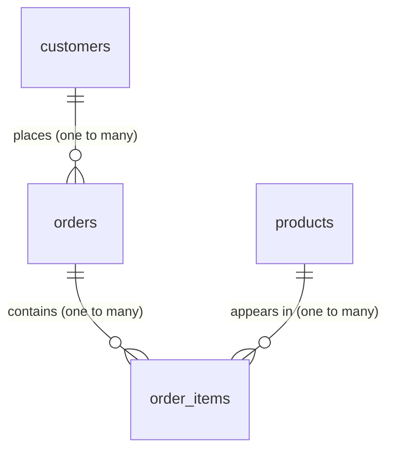

# Chapter 3: Joins and Set Operations

**You will learn:** why data is split across tables, how keys connect them, how to combine tables with every kind of join, how a table can join to itself, and how to stack query results with `UNION`, `INTERSECT` and `EXCEPT`.

**Before you start:** be comfortable with Chapters 1 and 2, especially `GROUP BY` and `NULL`. Make sure `sql/schema.sql` is loaded.

## Contents
1. [Why tables are split, and keys](#1-why-tables-are-split-and-keys)
2. [Two tiny tables to see every join](#2-two-tiny-tables-to-see-every-join)
3. [INNER JOIN](#3-inner-join)
4. [LEFT JOIN (and finding what's missing)](#4-left-join-and-finding-whats-missing)
5. [RIGHT and FULL JOIN](#5-right-and-full-join)
6. [CROSS JOIN](#6-cross-join)
7. [Self joins](#7-self-joins)
8. [Join traps to avoid](#8-join-traps-to-avoid)
9. [Set operations: UNION, INTERSECT, EXCEPT](#9-set-operations-union-intersect-except)
10. [Chapter 3 cheat sheet](#10-chapter-3-cheat-sheet)
11. [Practice problems](#11-practice-problems)
12. [Solutions](#12-solutions)

[← Back to table of contents](../README.md) · SQL files: [`chapter-03-examples.sql`](../sql/chapter-03-examples.sql), [`chapter-03-solutions.sql`](../sql/chapter-03-solutions.sql)

---

## 1. Why tables are split, and keys

Imagine one giant sheet where every order row repeats the customer's name, city and signup date. If Asha changes her city, you'd have to fix it in every one of her orders, and miss one, and your data disagrees with itself.

So we store each fact **once**, in its own table, and link tables using ID numbers. Joins are how you put them back together when you need to.

```
   customers                         orders
  ┌─────────────┬────────┐         ┌──────────┬─────────────┬────────────┐
  │ customer_id │ name   │         │ order_id │ customer_id │ order_date │
  ├─────────────┼────────┤         ├──────────┼─────────────┼────────────┤
  │ 1           │ Asha   │◄────────│ 1        │ 1           │ 2024-05-01 │
  │ 2           │ Ben    │◄───┐    │ 2        │ 1           │ 2024-06-10 │
  │ 3           │ Chitra │    └────│ 3        │ 2           │ 2024-06-12 │
  └─────────────┴────────┘         └──────────┴─────────────┴────────────┘
   PRIMARY KEY: customer_id          FOREIGN KEY: customer_id points back
```

| Term | Meaning |
|---|---|
| **Primary key (PK)** | A column that uniquely identifies each row (`customers.customer_id`). Never repeated, never NULL. |
| **Foreign key (FK)** | A column holding another table's primary key (`orders.customer_id`). It is the link. |
| **Referential integrity** | Postgres refuses an order whose `customer_id` doesn't exist in `customers`, so no "orphan" rows. |

### Relationship types



| Type | Example | How it's stored |
|---|---|---|
| **One-to-many** | One customer has many orders | FK on the "many" side (`orders.customer_id`) |
| **Many-to-many** | An order has many products, and a product is in many orders | A **junction table** in the middle (`order_items`) holding both FKs |
| **One-to-one** | A person and their passport | FK that is also unique |

`order_items` is the junction table: it turns one many-to-many relationship into two one-to-many ones.

Try the integrity rule yourself (this should fail):

```sql
INSERT INTO orders (customer_id, order_date, status) VALUES (999, '2024-08-01', 'pending');
-- ERROR: insert or update on table "orders" violates foreign key constraint "orders_customer_id_fkey"
```

---

## 2. Two tiny tables to see every join

Before using the shop data, let's learn the join types with two tiny tables, `L` and `R`:

```
      L          R
    ┌───┐      ┌───┐
    │ 1 │      │ 2 │
    │ 2 │      │ 3 │
    │ 3 │      │ 4 │
    └───┘      └───┘
   Match rule:  L.x = R.y
   Matches:  2 with 2,  3 with 3.     1 has no partner.  4 has no partner.
```

```
              L  ┌───────────┐  R
                 │ 1         │
   INNER JOIN    │  ┌─────┐  │        only the matches            -> (2,2) (3,3)
                 │  │2  3 │  │
   LEFT JOIN     │  └─────┘  │        all of L + matches          -> (1,NULL) (2,2) (3,3)
   RIGHT JOIN    │         4 │        all of R + matches          -> (2,2) (3,3) (NULL,4)
   FULL JOIN     └───────────┘        everything from both        -> (1,NULL) (2,2) (3,3) (NULL,4)
```

You can run these yourself. `VALUES` builds a throwaway table:

```sql
-- INNER: only matches
SELECT l.x, r.y
FROM (VALUES (1), (2), (3)) AS l(x)
JOIN (VALUES (2), (3), (4)) AS r(y) ON l.x = r.y;

-- LEFT: all of L, with NULL where R has no match
SELECT l.x, r.y
FROM (VALUES (1), (2), (3)) AS l(x)
LEFT JOIN (VALUES (2), (3), (4)) AS r(y) ON l.x = r.y
ORDER BY l.x;

-- RIGHT: all of R, with NULL where L has no match
SELECT l.x, r.y
FROM (VALUES (1), (2), (3)) AS l(x)
RIGHT JOIN (VALUES (2), (3), (4)) AS r(y) ON l.x = r.y
ORDER BY r.y;

-- FULL: everything from both sides
SELECT l.x, r.y
FROM (VALUES (1), (2), (3)) AS l(x)
FULL JOIN (VALUES (2), (3), (4)) AS r(y) ON l.x = r.y
ORDER BY COALESCE(l.x, r.y);
```

| Join | Result rows | In words |
|---|---|---|
| `INNER` | (2,2) (3,3) | only rows that match on both sides |
| `LEFT` | (1,NULL) (2,2) (3,3) | every left row; NULLs where the right has no match |
| `RIGHT` | (2,2) (3,3) (NULL,4) | every right row; NULLs where the left has no match |
| `FULL` | (1,NULL) (2,2) (3,3) (NULL,4) | every row from both; NULLs on whichever side lacks a match |

Keep this picture in your head for the rest of the chapter.

---

## 3. INNER JOIN

**Idea:** pair up rows from two tables wherever the join condition is true. Rows without a partner are dropped.

**Analogy:** a dance where only people who find a partner stay on the floor.

```sql
SELECT o.order_id, c.name, o.order_date, o.status
FROM orders o
JOIN customers c ON c.customer_id = o.customer_id
ORDER BY o.order_id;
```

| order_id | name | order_date | status |
|---|---|---|---|
| 1 | Asha | 2024-05-01 | delivered |
| 2 | Asha | 2024-06-10 | delivered |
| 3 | Ben | 2024-06-12 | cancelled |
| 4 | Chitra | 2024-06-15 | delivered |
| 5 | Dev | 2024-07-01 | pending |
| 6 | Esha | 2024-07-04 | delivered |
| 7 | Chitra | 2024-07-20 | delivered |

```
   orders o                              customers c
   order_id  customer_id                 customer_id  name
   ────────  ───────────                 ───────────  ──────
   1         1  ────────────────────────► 1           Asha
   2         1  ────────────────────────► 1           Asha
   3         2  ────────────────────────► 2           Ben
   ...                                                          Farhan (6) has no order, so he is dropped
```

How to read the syntax:

```
   FROM  orders o                          <- the first table, with the nickname "o"
   JOIN  customers c                       <- the second table, nickname "c"
   ON    c.customer_id = o.customer_id     <- how to match them
```

- **Aliases** (`o`, `c`) are short nicknames. Write `table nickname` after the table name.
- `JOIN` alone means `INNER JOIN`. Both are the same.
- **Prefix columns with the alias** (`c.name`). When both tables have a column called `customer_id`, an unprefixed `customer_id` is ambiguous:

```sql
SELECT customer_id, name FROM customers c JOIN orders o ON c.customer_id = o.customer_id;
-- ERROR: column reference "customer_id" is ambiguous
```

### USING: a shortcut when column names match

```sql
SELECT customer_id, c.name, o.order_id
FROM customers c
JOIN orders o USING (customer_id)
ORDER BY o.order_id
LIMIT 2;
```

`USING (customer_id)` is shorthand for `ON c.customer_id = o.customer_id`, and the column appears once. It only works when both tables use exactly the same column name.

### Joining three or more tables

Keep chaining `JOIN`s. Each new `JOIN ... ON ...` connects to something already there:

```sql
SELECT o.order_id, c.name AS customer, p.name AS product,
       oi.quantity, oi.quantity * p.price AS line_total
FROM order_items oi
JOIN orders o    ON o.order_id    = oi.order_id
JOIN customers c ON c.customer_id = o.customer_id
JOIN products p  ON p.product_id  = oi.product_id
WHERE o.order_id IN (1, 2)
ORDER BY oi.order_item_id;
```

| order_id | customer | product | quantity | line_total |
|---|---|---|---|---|
| 1 | Asha | Laptop | 1 | 55000.00 |
| 1 | Asha | Headphones | 2 | 5000.00 |
| 2 | Asha | Notebook | 10 | 600.00 |
| 2 | Asha | Pen | 20 | 200.00 |

```
   order_items ──► orders ──► customers
        │
        └──────► products          (a chain: each JOIN hooks onto the previous ones)
```

**Tip:** build joins in layers. Start with two tables and check the result, add the third, check again. When a result looks wrong, you'll know which join caused it.

### Joins plus GROUP BY: the everyday combo

Everything from Chapter 2 still works on joined data. Revenue by product:

```sql
SELECT p.name, SUM(oi.quantity) AS units, SUM(oi.quantity * p.price) AS revenue
FROM products p
JOIN order_items oi ON oi.product_id = p.product_id
GROUP BY p.product_id, p.name
ORDER BY revenue DESC;
```

| name | units | revenue |
|---|---|---|
| Laptop | 2 | 110000.00 |
| Phone | 2 | 60000.00 |
| Headphones | 4 | 10000.00 |
| Desk Lamp | 2 | 2400.00 |
| Notebook | 15 | 900.00 |
| Pen | 20 | 200.00 |

Order of operations (from Chapter 2) for joined queries: `FROM` and `JOIN` happen first, building the combined rows, then `WHERE`, `GROUP BY`, and the rest.

### The old comma syntax (you'll see it in old code)

```sql
SELECT c.name, o.order_id
FROM customers c, orders o
WHERE c.customer_id = o.customer_id;
```

This is an inner join written the old way. Prefer `JOIN ... ON`: it keeps the join rule separate from filtering, and it's much harder to accidentally forget (see the trap in section 8).

---

## 4. LEFT JOIN (and finding what's missing)

**Idea:** keep **every row from the left table**. Where the right table has no match, its columns come back as `NULL`.

```sql
SELECT c.name, o.order_id, o.status
FROM customers c
LEFT JOIN orders o ON o.customer_id = c.customer_id
ORDER BY c.customer_id, o.order_id;
```

```
   customers (LEFT)           orders (RIGHT)            result
   ┌────┬────────┐           ┌─────┬──────┐           ┌────────┬──────────┐
   │ 1  │ Asha   │ ────────► │ 1,2 │      │   ──►     │ Asha   │ 1        │
   │ 1  │        │           └─────┴──────┘           │ Asha   │ 2        │
   │ 2  │ Ben    │ ────────► 3                        │ Ben    │ 3        │
   │ .. │ ...    │                                    │ ...    │ ...      │
   │ 6  │ Farhan │ ──── no match ────►  (NULL)  ──►   │ Farhan │ NULL     │ ◄─ kept, with NULLs
   └────┴────────┘                                    └────────┴──────────┘
```

Farhan is now in the result with `NULL` in the order columns. An `INNER JOIN` would have dropped him.

### Counting with LEFT JOIN: use the right column

```sql
SELECT c.name, COUNT(o.order_id) AS orders, COUNT(*) AS wrong_count
FROM customers c
LEFT JOIN orders o ON o.customer_id = c.customer_id
GROUP BY c.customer_id, c.name
ORDER BY c.customer_id;
```

| name | orders | wrong_count |
|---|---|---|
| Asha | 2 | 2 |
| Ben | 1 | 1 |
| Chitra | 2 | 2 |
| Dev | 1 | 1 |
| Esha | 1 | 1 |
| Farhan | 0 | **1** |

`COUNT(*)` counts the row Farhan has (the one with NULLs), so it says `1`. `COUNT(o.order_id)` counts only real, non-NULL order ids (Chapter 2: `COUNT(col)` skips NULLs), so it correctly says `0`. After a `LEFT JOIN`, count a column from the **right** table.

### The anti-join: "who has nothing?"

One of the most useful patterns in SQL. Keep the unmatched left rows with `WHERE right_key IS NULL`:

```sql
SELECT c.name
FROM customers c
LEFT JOIN orders o ON o.customer_id = c.customer_id
WHERE o.order_id IS NULL;
```

| name |
|---|
| Farhan |

```
   LEFT JOIN gives:   Asha+order, Asha+order, Ben+order, ..., Farhan+NULL
   WHERE order_id IS NULL keeps only:                         Farhan+NULL
```

This works because a real order always has an `order_id`, so a `NULL` there can only mean "no match was found". The same pattern answers "products never sold", "employees with no reports", and so on.

### ON vs WHERE in a LEFT JOIN (a very common mistake)

Suppose you want **every customer, showing only their delivered orders**.

```sql
-- Version A: condition in ON
SELECT c.name, o.order_id, o.status
FROM customers c
LEFT JOIN orders o ON o.customer_id = c.customer_id AND o.status = 'delivered'
ORDER BY c.customer_id, o.order_id;
```

| name | order_id | status |
|---|---|---|
| Asha | 1 | delivered |
| Asha | 2 | delivered |
| Ben | NULL | NULL |
| Chitra | 4 | delivered |
| Chitra | 7 | delivered |
| Dev | NULL | NULL |
| Esha | 6 | delivered |
| Farhan | NULL | NULL |

```sql
-- Version B: condition in WHERE
SELECT c.name, o.order_id, o.status
FROM customers c
LEFT JOIN orders o ON o.customer_id = c.customer_id
WHERE o.status = 'delivered'
ORDER BY c.customer_id, o.order_id;
```

Version B returns only 5 rows (Asha, Asha, Chitra, Chitra, Esha). Ben, Dev and Farhan vanished.

```
   ON    : decides WHICH right-side rows can match.      Unmatched left rows still survive.
   WHERE : filters the FINISHED result.                  NULL = 'delivered' is not true, so
                                                         the NULL rows are thrown away.
```

So `WHERE` on a right-table column quietly turns a `LEFT JOIN` into an `INNER JOIN`. **Rule:** conditions on the right table that you want to apply *before* matching go in `ON`.

The ON-version also answers "customers with **no delivered** orders":

```sql
SELECT c.name
FROM customers c
LEFT JOIN orders o ON o.customer_id = c.customer_id AND o.status = 'delivered'
WHERE o.order_id IS NULL
ORDER BY c.customer_id;
```

| name |
|---|
| Ben |
| Dev |
| Farhan |

Ben has an order, but it was cancelled, so no delivered order matched.

### A longer LEFT JOIN: delivered revenue per customer, zero for none

```sql
SELECT c.name, COALESCE(SUM(oi.quantity * p.price), 0) AS delivered_revenue
FROM customers c
LEFT JOIN orders o       ON o.customer_id = c.customer_id AND o.status = 'delivered'
LEFT JOIN order_items oi ON oi.order_id   = o.order_id
LEFT JOIN products p     ON p.product_id  = oi.product_id
GROUP BY c.customer_id, c.name
ORDER BY c.customer_id;
```

| name | delivered_revenue |
|---|---|
| Asha | 60800.00 |
| Ben | 0 |
| Chitra | 57700.00 |
| Dev | 0 |
| Esha | 32500.00 |
| Farhan | 0 |

When you chain joins after a `LEFT JOIN`, keep them `LEFT` too. A later `INNER JOIN` would drop the customers you worked to keep. `SUM` of nothing is `NULL` (Chapter 2), so `COALESCE(..., 0)` turns it into a clean zero.

---

## 5. RIGHT and FULL JOIN

### RIGHT JOIN

The mirror image of `LEFT JOIN`: keep every row from the **right** table.

```sql
SELECT c.name, o.order_id
FROM orders o
RIGHT JOIN customers c ON c.customer_id = o.customer_id
ORDER BY c.customer_id;
```

This gives exactly the same rows as `customers c LEFT JOIN orders o ...`. Swap the table order and you can always turn a `RIGHT JOIN` into a `LEFT JOIN`. Most people write `LEFT JOIN` only, because "start with the table I care about and keep all of it" reads more naturally.

### FULL JOIN

Keeps every row from **both** sides, with NULLs wherever there's no partner. You saw it in section 2:

```
   FULL JOIN of L (1,2,3) and R (2,3,4):    (1,NULL)  (2,2)  (3,3)  (NULL,4)
```

It's the right tool for **comparing two lists** and spotting what's in one but not the other, for example reconciling two systems' customer lists. In our shop tables, foreign keys make it impossible to have an order without a customer, so there's no natural both-sided mismatch. That's why FULL JOIN is rare in day-to-day work.

---

## 6. CROSS JOIN

**Idea:** pair **every** row of one table with **every** row of the other. No `ON` condition.

```sql
SELECT s.size, c.colour
FROM (VALUES ('S'), ('M'), ('L')) AS s(size)
CROSS JOIN (VALUES ('Red'), ('Blue')) AS c(colour);
```

| size | colour |
|---|---|
| S | Red |
| S | Blue |
| M | Red |
| M | Blue |
| L | Red |
| L | Blue |

```
   3 sizes  ×  2 colours  =  6 combinations
   rows in result = rows in A  ×  rows in B
```

It's perfect for generating combinations: every size/colour, every day/store, every product/month for a report grid. It's also the accidental disaster in section 8: `customers CROSS JOIN products` is 6 × 6 = 36 rows, and with big tables the multiplication explodes.

---

## 7. Self joins

**Idea:** a table joined to **itself**, as if it were two copies. Needed when a table has a column that points to its own rows. In `employees`, `manager_id` points to another row in the same table.

**Analogy:** a staff list where each person's "boss" is just another person on the same list. To print "employee, boss", look up the boss's row in the same list.

```
   employees e (the worker)                     employees m (the boss, same table!)
   ┌─────────────┬───────┬────────────┐        ┌─────────────┬───────┐
   │ employee_id │ name  │ manager_id │        │ employee_id │ name  │
   │ 2           │ Meera │ 1  ────────┼───────►│ 1           │ Rohan │
   │ 3           │ Karan │ 2  ────────┼───────►│ 2           │ Meera │
   └─────────────┴───────┴────────────┘        └─────────────┴───────┘
```

You **must** use two different aliases, since the same table appears twice:

```sql
SELECT e.name AS employee, m.name AS manager
FROM employees e
LEFT JOIN employees m ON m.employee_id = e.manager_id
ORDER BY e.employee_id;
```

| employee | manager |
|---|---|
| Rohan | NULL |
| Meera | Rohan |
| Karan | Meera |
| Sneha | Meera |
| Imran | Rohan |
| Priya | Imran |
| Tanvi | Rohan |

Why `LEFT JOIN`? Rohan has `manager_id = NULL` (he's the top). A `NULL` never matches anything, so an `INNER JOIN` would silently drop him.

### Using the joined columns

```sql
-- how much less does each person earn than their manager?
SELECT e.name, COALESCE(m.name, 'None') AS manager, m.salary - e.salary AS gap
FROM employees e
LEFT JOIN employees m ON m.employee_id = e.manager_id
ORDER BY e.employee_id;

-- how many direct reports does each manager have?
SELECT m.name AS manager, COUNT(*) AS reports
FROM employees e
JOIN employees m ON m.employee_id = e.manager_id
GROUP BY m.employee_id, m.name
ORDER BY reports DESC, m.name;
```

| manager | reports |
|---|---|
| Rohan | 3 |
| Meera | 2 |
| Imran | 1 |

### Self join without a key: pairs in the same department

A join condition doesn't have to be a key. Any condition works:

```sql
SELECT a.name AS person_1, b.name AS person_2, a.department
FROM employees a
JOIN employees b ON a.department = b.department
                AND a.employee_id < b.employee_id
ORDER BY a.employee_id, b.employee_id;
```

| person_1 | person_2 | department |
|---|---|---|
| Meera | Karan | Engineering |
| Meera | Sneha | Engineering |
| Karan | Sneha | Engineering |
| Imran | Priya | Sales |

The `a.employee_id < b.employee_id` part does two jobs: it stops a person pairing with themselves, and it lists each pair once (Meera-Karan but not also Karan-Meera).

---

## 8. Join traps to avoid

### Trap 1: the forgotten join condition

```sql
SELECT COUNT(*) FROM customers c, orders o;     -- 42 rows!  (6 customers × 7 orders)
```

With the comma syntax, forgetting the `WHERE c.customer_id = o.customer_id` silently produces a cross join. With `JOIN`, Postgres forces you to write `ON`, which is one more reason to prefer it.

### Trap 2: fan-out (row multiplication)

Joining a "one" table to a "many" table repeats the "one" side's values. Chain two such joins and counts inflate:

```sql
SELECT c.name,
       COUNT(*)                   AS wrong_orders,
       COUNT(DISTINCT o.order_id) AS real_orders,
       SUM(oi.quantity)           AS items
FROM customers c
JOIN orders o       ON o.customer_id = c.customer_id
JOIN order_items oi ON oi.order_id   = o.order_id
GROUP BY c.customer_id, c.name
ORDER BY c.customer_id;
```

| name | wrong_orders | real_orders | items |
|---|---|---|---|
| Asha | 4 | 2 | 33 |
| Ben | 1 | 1 | 1 |
| Chitra | 3 | 2 | 8 |
| Dev | 1 | 1 | 1 |
| Esha | 2 | 1 | 2 |

```
   Asha has 2 orders, but order 1 has 2 items and order 2 has 2 items.
   After joining to order_items, Asha appears on 4 rows.  COUNT(*) counts those 4.
   COUNT(DISTINCT o.order_id) counts the 2 genuine orders.
```

**Habit:** after every join, ask "could this multiply my rows?" and count carefully (`COUNT(DISTINCT key)`) when it can.

### Trap 3: WHERE turning a LEFT JOIN into an INNER JOIN

Covered in section 4. Filter the right table in `ON`, not `WHERE`.

### Trap 4: NULL keys never match

`NULL = NULL` is unknown (Chapter 1), so rows whose join column is `NULL` never find a partner in a normal join. That is why Rohan disappeared in an inner self join.

### Trap 5: ambiguous columns

If both tables have a column with the same name, always prefix it with the alias (`c.customer_id`).

### Trap 6: joining on the wrong columns

A join on columns that merely have matching *types* (say `o.order_id = c.customer_id`) will run happily and give nonsense. Always join foreign key to the primary key it points to.

---

## 9. Set operations: UNION, INTERSECT, EXCEPT

**Joins combine tables side by side (more columns). Set operations stack results on top of each other (more rows).**

```
   JOIN                              SET OPERATIONS
   ┌───┐   ┌───┐   ┌───┬───┐        ┌───┐
   │ A │ + │ B │ = │ A │ B │        │ A │      ┌───┐
   └───┘   └───┘   └───┴───┘        └───┘  +   │ B │   =   one taller table
   wider                             ┌───┐      └───┘
                                     │ B │
                                     └───┘
```

**Rules:** both queries need the **same number of columns** with **compatible types**. Column names come from the first query. `ORDER BY` goes once, at the very end.

Our example: which customers ordered in June, and which in July?

```
   June:  customers 1, 2, 3          July:  customers 3, 4, 5
```

```
        June        July
       ┌─────────────────┐
       │  1   ┌────┐  4  │
       │  2   │ 3  │  5  │
       │      └────┘     │
       └─────────────────┘
        UNION      all: 1,2,3,4,5          (union of the two circles)
        INTERSECT  overlap: 3              (in both)
        EXCEPT     June minus July: 1,2    (in the first, not in the second)
```

### UNION: combine and remove duplicates

```sql
SELECT customer_id FROM orders WHERE order_date >= '2024-06-01' AND order_date < '2024-07-01'
UNION
SELECT customer_id FROM orders WHERE order_date >= '2024-07-01' AND order_date < '2024-08-01'
ORDER BY customer_id;
```

Result: 1, 2, 3, 4, 5 (five rows; customer 3 appears once).

### UNION ALL: combine and keep duplicates

```sql
SELECT customer_id FROM orders WHERE order_date >= '2024-06-01' AND order_date < '2024-07-01'
UNION ALL
SELECT customer_id FROM orders WHERE order_date >= '2024-07-01' AND order_date < '2024-08-01'
ORDER BY customer_id;
```

Result: 1, 2, 3, 3, 4, 5 (six rows; customer 3 appears twice).

| | Removes duplicates? | Speed |
|---|---|---|
| `UNION` | Yes | Slower (must sort/compare to find duplicates) |
| `UNION ALL` | No | Faster |

Use `UNION ALL` when you know there are no duplicates, or you want them. Use `UNION` only when you need duplicates removed.

### INTERSECT: only rows in both

```sql
SELECT customer_id FROM orders WHERE order_date >= '2024-06-01' AND order_date < '2024-07-01'
INTERSECT
SELECT customer_id FROM orders WHERE order_date >= '2024-07-01' AND order_date < '2024-08-01';
```

Result: 3. Chitra ordered in both months.

### EXCEPT: in the first, but not in the second

```sql
SELECT customer_id FROM orders WHERE order_date >= '2024-06-01' AND order_date < '2024-07-01'
EXCEPT
SELECT customer_id FROM orders WHERE order_date >= '2024-07-01' AND order_date < '2024-08-01'
ORDER BY customer_id;
```

Result: 1, 2. Order matters here: swapping the two queries would give 4, 5.

`EXCEPT` is another way to write an anti-join:

```sql
SELECT customer_id FROM customers
EXCEPT
SELECT customer_id FROM orders;       -- 6 (Farhan)
```

Compare it to the `LEFT JOIN ... IS NULL` version from section 4. `EXCEPT` only returns the key columns you select, whereas the join lets you also pull other columns like `name`.

**Notes:** `UNION`, `INTERSECT` and `EXCEPT` treat `NULL`s as equal to each other for duplicate-checking (unlike `=`), and they all remove duplicates. Only `UNION ALL` keeps them.

---

## 10. Chapter 3 cheat sheet

```sql
SELECT   a.col, b.col
FROM     table_a a
JOIN     table_b b  ON b.a_id = a.id         -- INNER: matches only
LEFT JOIN table_c c ON c.a_id = a.id         -- keep all of a
WHERE    ...
```

| I want to... | Use |
|---|---|
| Only rows that match on both sides | `INNER JOIN` (or just `JOIN`) |
| All rows from my main table, matches if any | `LEFT JOIN` |
| Find rows with **no** match | `LEFT JOIN ... WHERE right.key IS NULL` |
| Everything from both, flagging mismatches | `FULL JOIN` |
| Every combination | `CROSS JOIN` |
| Hierarchy inside one table | self join with two aliases |
| Stack results, remove duplicates | `UNION` |
| Stack results, keep duplicates | `UNION ALL` |
| Rows in both results | `INTERSECT` |
| Rows in first but not second | `EXCEPT` |

**Things never to forget**
1. Join foreign key to primary key, and prefix columns with aliases.
2. After a `LEFT JOIN`, filter the right table in `ON`, not `WHERE`, or it becomes an inner join.
3. After a `LEFT JOIN`, count a column from the right table, not `COUNT(*)`.
4. Joining one-to-many multiplies rows. Watch your counts.
5. `NULL` keys never match.
6. `UNION` removes duplicates, `UNION ALL` doesn't.

---

## 11. Practice problems

Type each query yourself. Say it in English first. Build joins one table at a time.

### Easy
1. Show every order with the customer's name: `order_id`, `name`, `order_date`, `status`.
2. Show every order item with its product name and quantity.
3. Show every customer with their number of orders, including customers with zero.
4. Show customers who have never placed an order.
5. Show each employee with their manager's name, using `'None'` for the top boss.
6. Generate every combination of the sizes `S`, `M`, `L` and the colours `Red`, `Blue`, `Green`. How many rows do you expect?

### Medium
7. For delivered orders only, show customer name, product name, quantity and `line_total` (quantity times price).
8. Show total revenue per product (all orders), with the product name, highest first.
9. Show delivered revenue per customer, with `0` for customers who have none.
10. Show customers who have no delivered orders.
11. Show each manager's name and how many direct reports they have.
12. Show every pair of employees in the same department, listing each pair once.
13. Show the best-selling product by units sold, breaking ties by name.
14. Show the number of orders per customer city, labelling a missing city `'Unknown'`.
15. List the `customer_id`s that ordered in June **or** July, once with `UNION` and once with `UNION ALL`. How do the row counts differ, and why?
16. List customers who ordered in June but **not** in July.

### Challenging
17. For each customer who has ordered, show the number of distinct orders and the total number of items bought, without inflating either figure.
18. For every employee, show how much less they earn than their manager. The top boss should show `NULL`.
19. Show the names of customers who bought at least one Electronics product (each name once).
20. Predict the output first, then run:
    ```sql
    SELECT COUNT(*) FROM customers c LEFT JOIN orders o ON o.customer_id = c.customer_id;
    SELECT COUNT(o.order_id) FROM customers c LEFT JOIN orders o ON o.customer_id = c.customer_id;
    SELECT COUNT(*) FROM customers c JOIN orders o ON o.customer_id = c.customer_id;
    SELECT COUNT(*) FROM customers c CROSS JOIN orders o;
    ```
21. Each of these has a mistake. Explain what's wrong and fix it:
    ```sql
    -- (a)
    SELECT customer_id, name FROM customers c JOIN orders o ON c.customer_id = o.customer_id;
    -- (b) goal: all customers, plus their pending orders if they have any
    SELECT c.name, o.order_id FROM customers c
    LEFT JOIN orders o ON o.customer_id = c.customer_id
    WHERE o.status = 'pending';
    -- (c) goal: the number of orders per customer
    SELECT c.name, COUNT(*) AS orders FROM customers c
    LEFT JOIN orders o ON o.customer_id = c.customer_id
    GROUP BY c.name;
    ```

**Self-check: you've mastered Chapter 3 when you can explain, without notes:**
- the difference between `INNER`, `LEFT`, `RIGHT` and `FULL` (draw the two circles),
- how to find rows with no match,
- why a `WHERE` on the right table breaks a `LEFT JOIN`,
- why joining orders to order items inflates counts,
- the difference between `UNION` and `UNION ALL`.

---

## 12. Solutions

<details>
<summary><b>Click to reveal (try first!)</b></summary>

```sql
-- 1
SELECT o.order_id, c.name, o.order_date, o.status
FROM orders o
JOIN customers c ON c.customer_id = o.customer_id;

-- 2
SELECT oi.order_id, p.name AS product, oi.quantity
FROM order_items oi
JOIN products p ON p.product_id = oi.product_id;

-- 3
SELECT c.name, COUNT(o.order_id) AS orders
FROM customers c
LEFT JOIN orders o ON o.customer_id = c.customer_id
GROUP BY c.customer_id, c.name;

-- 4
SELECT c.name
FROM customers c
LEFT JOIN orders o ON o.customer_id = c.customer_id
WHERE o.order_id IS NULL;                                         -- Farhan

-- 5
SELECT e.name AS employee, COALESCE(m.name, 'None') AS manager
FROM employees e
LEFT JOIN employees m ON m.employee_id = e.manager_id;

-- 6
SELECT s.size, c.colour
FROM (VALUES ('S'), ('M'), ('L')) AS s(size)
CROSS JOIN (VALUES ('Red'), ('Blue'), ('Green')) AS c(colour);    -- 3 x 3 = 9 rows

-- 7
SELECT c.name AS customer, p.name AS product, oi.quantity, oi.quantity * p.price AS line_total
FROM orders o
JOIN customers c   ON c.customer_id = o.customer_id
JOIN order_items oi ON oi.order_id  = o.order_id
JOIN products p    ON p.product_id  = oi.product_id
WHERE o.status = 'delivered';

-- 8
SELECT p.name, SUM(oi.quantity * p.price) AS revenue
FROM products p
JOIN order_items oi ON oi.product_id = p.product_id
GROUP BY p.product_id, p.name
ORDER BY revenue DESC;

-- 9
SELECT c.name, COALESCE(SUM(oi.quantity * p.price), 0) AS delivered_revenue
FROM customers c
LEFT JOIN orders o       ON o.customer_id = c.customer_id AND o.status = 'delivered'
LEFT JOIN order_items oi ON oi.order_id   = o.order_id
LEFT JOIN products p     ON p.product_id  = oi.product_id
GROUP BY c.customer_id, c.name;                                   -- Asha 60800, Chitra 57700, Esha 32500, others 0

-- 10
SELECT c.name
FROM customers c
LEFT JOIN orders o ON o.customer_id = c.customer_id AND o.status = 'delivered'
WHERE o.order_id IS NULL;                                         -- Ben, Dev, Farhan

-- 11
SELECT m.name AS manager, COUNT(*) AS reports
FROM employees e
JOIN employees m ON m.employee_id = e.manager_id
GROUP BY m.employee_id, m.name;                                   -- Rohan 3, Meera 2, Imran 1

-- 12
SELECT a.name AS person_1, b.name AS person_2, a.department
FROM employees a
JOIN employees b ON a.department = b.department AND a.employee_id < b.employee_id;   -- 4 pairs

-- 13
SELECT p.name, SUM(oi.quantity) AS units
FROM products p
JOIN order_items oi ON oi.product_id = p.product_id
GROUP BY p.product_id, p.name
ORDER BY units DESC, p.name
LIMIT 1;                                                          -- Pen (20)

-- 14
SELECT COALESCE(c.city, 'Unknown') AS city, COUNT(*) AS orders
FROM customers c
JOIN orders o ON o.customer_id = c.customer_id
GROUP BY COALESCE(c.city, 'Unknown')
ORDER BY orders DESC, city;                                       -- Mumbai 4, Bengaluru 1, Delhi 1, Unknown 1

-- 15
SELECT customer_id FROM orders WHERE order_date >= '2024-06-01' AND order_date < '2024-07-01'
UNION
SELECT customer_id FROM orders WHERE order_date >= '2024-07-01' AND order_date < '2024-08-01';      -- 5 rows

SELECT customer_id FROM orders WHERE order_date >= '2024-06-01' AND order_date < '2024-07-01'
UNION ALL
SELECT customer_id FROM orders WHERE order_date >= '2024-07-01' AND order_date < '2024-08-01';      -- 6 rows
-- Customer 3 ordered in both months. UNION keeps one copy; UNION ALL keeps both.

-- 16
SELECT customer_id FROM orders WHERE order_date >= '2024-06-01' AND order_date < '2024-07-01'
EXCEPT
SELECT customer_id FROM orders WHERE order_date >= '2024-07-01' AND order_date < '2024-08-01';      -- 1, 2

-- 17
SELECT c.name,
       COUNT(DISTINCT o.order_id) AS orders,
       SUM(oi.quantity)           AS items
FROM customers c
JOIN orders o       ON o.customer_id = c.customer_id
JOIN order_items oi ON oi.order_id   = o.order_id
GROUP BY c.customer_id, c.name;                                   -- Asha 2/33, Ben 1/1, Chitra 2/8, Dev 1/1, Esha 1/2

-- 18
SELECT e.name, m.salary - e.salary AS gap
FROM employees e
LEFT JOIN employees m ON m.employee_id = e.manager_id
ORDER BY e.employee_id;

-- 19
SELECT DISTINCT c.name
FROM customers c
JOIN orders o       ON o.customer_id = c.customer_id
JOIN order_items oi ON oi.order_id   = o.order_id
JOIN products p     ON p.product_id  = oi.product_id
WHERE p.category = 'Electronics'
ORDER BY c.name;                                                  -- Asha, Ben, Chitra, Dev, Esha

-- 20 (predicted results)
SELECT COUNT(*) FROM customers c LEFT JOIN orders o ON o.customer_id = c.customer_id;        -- 8 (7 orders + Farhan's NULL row)
SELECT COUNT(o.order_id) FROM customers c LEFT JOIN orders o ON o.customer_id = c.customer_id; -- 7 (NULL not counted)
SELECT COUNT(*) FROM customers c JOIN orders o ON o.customer_id = c.customer_id;             -- 7
SELECT COUNT(*) FROM customers c CROSS JOIN orders o;                                        -- 42 (6 x 7)

-- 21
-- (a) "customer_id" exists in both tables, so it's ambiguous. Prefix it:
SELECT c.customer_id, c.name FROM customers c JOIN orders o ON c.customer_id = o.customer_id;
-- (b) WHERE on the right table removes customers with no pending order. Move it into ON:
SELECT c.name, o.order_id FROM customers c
LEFT JOIN orders o ON o.customer_id = c.customer_id AND o.status = 'pending';
-- (c) COUNT(*) counts Farhan's NULL row as 1. Count a right-table column:
SELECT c.name, COUNT(o.order_id) AS orders FROM customers c
LEFT JOIN orders o ON o.customer_id = c.customer_id
GROUP BY c.name;
```

</details>

---

*End of Chapter 3.*

**Next:** Chapter 4: Subqueries and CTEs (queries inside queries, `EXISTS` vs `IN`, `WITH`, and recursive CTEs).
