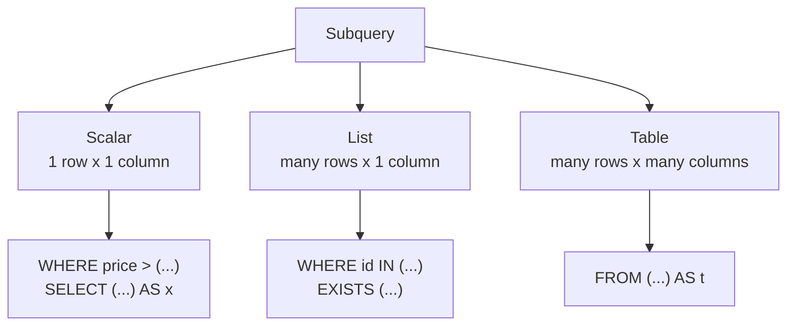

# Chapter 4: Subqueries and CTEs

**You will learn:** how to put one query inside another, the three shapes a subquery can return, correlated subqueries, `EXISTS` vs `IN`, how to write long queries as readable steps with `WITH` (CTEs), and how recursive CTEs walk through hierarchies like an org chart.

**Before you start:** be comfortable with Chapters 1 to 3, especially `GROUP BY` and `LEFT JOIN`. Make sure `sql/schema.sql` is loaded.

## Contents
1. [What is a subquery?](#1-what-is-a-subquery)
2. [Scalar subqueries: one value](#2-scalar-subqueries-one-value)
3. [Subqueries that return a list: IN and NOT IN](#3-subqueries-that-return-a-list-in-and-not-in)
4. [Subqueries in FROM (derived tables)](#4-subqueries-in-from-derived-tables)
5. [Subqueries in SELECT](#5-subqueries-in-select)
6. [Correlated subqueries](#6-correlated-subqueries)
7. [EXISTS and NOT EXISTS](#7-exists-and-not-exists)
8. [ANY and ALL](#8-any-and-all)
9. [The Nth highest value pattern](#9-the-nth-highest-value-pattern)
10. [CTEs: queries as recipe steps](#10-ctes-queries-as-recipe-steps)
11. [Recursive CTEs: walking hierarchies](#11-recursive-ctes-walking-hierarchies)
12. [Chapter 4 cheat sheet](#12-chapter-4-cheat-sheet)
13. [Practice problems](#13-practice-problems)
14. [Solutions](#14-solutions)

[← Back to table of contents](../README.md) · SQL files: [`chapter-04-examples.sql`](../sql/chapter-04-examples.sql), [`chapter-04-solutions.sql`](../sql/chapter-04-solutions.sql)

---

## 1. What is a subquery?

**Idea:** a query written inside another query, in parentheses.

**Analogy:** "Which products cost more than average?" is really **two questions**. First: *what is the average?* Then: *which products beat it?* A subquery lets you ask the first question inside the second.

```
   SELECT name, price
   FROM products
   WHERE price > ( SELECT AVG(price) FROM products );
                   └─────────── inner query ───────┘
                   runs first, produces 14795.00
                   so the outer query becomes:  WHERE price > 14795.00
```

The **inner** query runs first and hands its answer to the **outer** query.

A subquery can live in three places, and what it **returns** decides where it fits:

| It returns | Called | Can be used... |
|---|---|---|
| One value (1 row, 1 column) | **Scalar** subquery | anywhere a single value goes: `WHERE price > (...)`, in `SELECT` |
| One column, many rows | **List** subquery | with `IN`, `ANY`, `ALL`, `EXISTS` |
| A table (many rows, many columns) | **Derived table** | in `FROM`, like a temporary table |



---

## 2. Scalar subqueries: one value

A scalar subquery returns exactly **one row and one column**, so you can use it like a plain number.

```sql
-- products priced above the average
SELECT name, price
FROM products
WHERE price > (SELECT AVG(price) FROM products)
ORDER BY price DESC;
```

| name | price |
|---|---|
| Laptop | 55000.00 |
| Phone | 30000.00 |

```sql
-- employees earning more than the company average (92142.86)
SELECT name, salary
FROM employees
WHERE salary > (SELECT AVG(salary) FROM employees)
ORDER BY salary DESC;
```

| name | salary |
|---|---|
| Rohan | 150000.00 |
| Meera | 120000.00 |

```sql
-- the most expensive product(s)
SELECT name, price
FROM products
WHERE price = (SELECT MAX(price) FROM products);
```

**Why do we need the subquery?** You can't write `WHERE price > AVG(price)`, because aggregates can't go in `WHERE` (Chapter 2: `WHERE` runs before any aggregate exists). The subquery computes the average separately first.

### Break it on purpose: more than one row

```sql
SELECT name FROM products WHERE price > (SELECT price FROM products WHERE category = 'Electronics');
-- ERROR: more than one row returned by a subquery used as an expression
```

The inner query returns three prices (55000, 30000, 2500), and `price > (three values)` makes no sense. Fix it by choosing what you mean:

```sql
SELECT name FROM products WHERE price > (SELECT MAX(price) FROM products WHERE category = 'Electronics');   -- above every Electronics price: none
SELECT name FROM products WHERE price > (SELECT MIN(price) FROM products WHERE category = 'Electronics');   -- above the cheapest Electronics item
```

If a scalar subquery returns **zero rows**, its value is `NULL`, and the comparison is unknown (no rows match).

---

## 3. Subqueries that return a list: IN and NOT IN

When the inner query returns one **column of many rows**, use `IN` to test "is the value in that list?".

```sql
-- customers who have placed at least one order
SELECT name
FROM customers
WHERE customer_id IN (SELECT customer_id FROM orders)
ORDER BY customer_id;
```

```
   inner query result:    customer_id from orders = 1, 1, 2, 3, 4, 5, 3
   outer query becomes:   WHERE customer_id IN (1, 1, 2, 3, 4, 5, 3)
   Asha(1) yes   Ben(2) yes   Chitra(3) yes   Dev(4) yes   Esha(5) yes   Farhan(6) NO
```

(Duplicates in the list don't matter.) The opposite:

```sql
-- customers who have never ordered
SELECT name FROM customers WHERE customer_id NOT IN (SELECT customer_id FROM orders);   -- Farhan
```

### The NOT IN trap: one NULL ruins everything

You met this in Chapter 1. Now we can see it happen for real. Which customer *names* are not also a city name? (None of them are, so we expect all 6.)

```sql
SELECT name FROM customers WHERE name NOT IN (SELECT city FROM customers);
```

**Result: 0 rows!** Because Dev's `city` is `NULL`, the list contains a `NULL`:

```
   'Asha' NOT IN ('Mumbai','Delhi','Mumbai',NULL,'Bengaluru','Delhi')
   =  'Asha'<>'Mumbai' AND 'Asha'<>'Delhi' AND ... AND 'Asha'<>NULL
        TRUE               TRUE                        UNKNOWN
   =  UNKNOWN   ──►  the row is dropped
```

Two safe fixes:

```sql
-- Fix 1: keep NULLs out of the list
SELECT name FROM customers
WHERE name NOT IN (SELECT city FROM customers WHERE city IS NOT NULL)
ORDER BY customer_id;                                                     -- all 6 names

-- Fix 2: use NOT EXISTS (section 7), which isn't fooled by NULLs
```

> **Rule:** prefer `NOT EXISTS` over `NOT IN` whenever the subquery column could contain `NULL`.

---

## 4. Subqueries in FROM (derived tables)

**Idea:** the inner query's *result* becomes a temporary table that the outer query reads from.

**Why?** Sometimes you need to aggregate **twice**: first per group, then over those results. Example: the **average number of orders per customer**. First count orders per customer, then average those counts.

```sql
SELECT AVG(n) AS avg_orders_per_customer
FROM (
    SELECT customer_id, COUNT(*) AS n
    FROM orders
    GROUP BY customer_id
) AS t;
```

```
   inner query (becomes table "t")          outer query
   ┌─────────────┬───┐
   │ customer_id │ n │
   ├─────────────┼───┤
   │ 1           │ 2 │
   │ 2           │ 1 │       ──►    AVG(n) = (2+1+2+1+1) / 5 = 1.4
   │ 3           │ 2 │
   │ 4           │ 1 │
   │ 5           │ 1 │
   └─────────────┴───┘
```

You can't write `AVG(COUNT(*))` directly, because aggregates can't nest. A derived table solves it.

**Always give a derived table an alias** (`AS t`). PostgreSQL 16 allows leaving it out, but older versions, and most other databases, raise an error, so make the alias a habit.

---

## 5. Subqueries in SELECT

A scalar subquery can also produce a **column** in the output:

```sql
-- each product, and how far it is from the average price
SELECT name, price,
       ROUND(price - (SELECT AVG(price) FROM products), 2) AS diff_from_avg
FROM products
ORDER BY price;
```

| name | price | diff_from_avg |
|---|---|---|
| Pen | 10.00 | -14785.00 |
| Notebook | 60.00 | -14735.00 |
| Desk Lamp | 1200.00 | -13595.00 |
| Headphones | 2500.00 | -12295.00 |
| Phone | 30000.00 | 15205.00 |
| Laptop | 55000.00 | 40205.00 |

The subquery here is independent: it gives the same average for every row. Next, one that *depends* on the row.

---

## 6. Correlated subqueries

**Idea:** a subquery that **refers to the outer query's current row**. It can't run alone, because it needs a value from outside.

**Analogy:** a teacher goes down the class list. For **each student**, she asks "is your mark above the average of *your own section*?". The question changes for every student.

```sql
-- how many orders has each customer placed?
SELECT c.name,
       (SELECT COUNT(*) FROM orders o WHERE o.customer_id = c.customer_id) AS orders
FROM customers c
ORDER BY c.customer_id;
```

```
   outer row: Asha (customer_id = 1)
        └──► inner:  SELECT COUNT(*) FROM orders WHERE customer_id = 1   ──► 2

   outer row: Ben (customer_id = 2)
        └──► inner:  SELECT COUNT(*) FROM orders WHERE customer_id = 2   ──► 1

   ...repeated for each outer row  (conceptually; Postgres may optimise this)
```

The link is `o.customer_id = c.customer_id`, which mentions `c` from the outer query.

### Compare to your group's average

```sql
-- employees who earn more than the average of their OWN department
SELECT e.name, e.department, e.salary
FROM employees e
WHERE e.salary > (SELECT AVG(x.salary)
                  FROM employees x
                  WHERE x.department = e.department)
ORDER BY e.employee_id;
```

| name | department | salary |
|---|---|---|
| Meera | Engineering | 120000.00 |
| Imran | Sales | 70000.00 |

Engineering averages 100000 (Meera beats it, Karan and Sneha don't). Sales averages 67500 (Imran beats it). Management and HR have one person each, who can't beat their own average.

```sql
-- products priced above the average of their own category
SELECT p.name, p.category, p.price
FROM products p
WHERE p.price > (SELECT AVG(x.price) FROM products x WHERE x.category = p.category)
ORDER BY p.product_id;                                          -- Laptop, Phone, Notebook
```

### The "latest row per group" pattern

```sql
-- each customer's most recent order
SELECT o.order_id, o.customer_id, o.order_date
FROM orders o
WHERE o.order_date = (SELECT MAX(x.order_date)
                      FROM orders x
                      WHERE x.customer_id = o.customer_id)
ORDER BY o.customer_id;
```

| order_id | customer_id | order_date |
|---|---|---|
| 2 | 1 | 2024-06-10 |
| 3 | 2 | 2024-06-12 |
| 7 | 3 | 2024-07-20 |
| 5 | 4 | 2024-07-01 |
| 6 | 5 | 2024-07-04 |

Notice the **different aliases** (`o` outside, `x` inside). Without them, `customer_id` could refer to either table. (Chapter 5's window functions will give you a neater way to do this.)

---

## 7. EXISTS and NOT EXISTS

**Idea:** `EXISTS (subquery)` is `TRUE` if the subquery returns **at least one row**. It doesn't care what the rows contain, only whether any exist.

```sql
-- customers who have at least one order
SELECT c.name
FROM customers c
WHERE EXISTS (SELECT 1 FROM orders o WHERE o.customer_id = c.customer_id)
ORDER BY c.customer_id;                                         -- Asha, Ben, Chitra, Dev, Esha

-- customers with no orders
SELECT c.name
FROM customers c
WHERE NOT EXISTS (SELECT 1 FROM orders o WHERE o.customer_id = c.customer_id);   -- Farhan
```

`SELECT 1` is just a convention. `EXISTS` ignores the selected column, so people write the cheapest thing.

```
   For each customer c:
      look in orders for a row with that customer_id
         found one?  ──►  EXISTS = TRUE     (can stop looking at the first match)
         found none? ──►  EXISTS = FALSE
```

### EXISTS with several tables inside

```sql
-- customers who bought at least one Electronics product
SELECT c.name
FROM customers c
WHERE EXISTS (
    SELECT 1
    FROM orders o
    JOIN order_items oi ON oi.order_id   = o.order_id
    JOIN products p     ON p.product_id  = oi.product_id
    WHERE o.customer_id = c.customer_id
      AND p.category = 'Electronics'
)
ORDER BY c.customer_id;                                         -- Asha, Ben, Chitra, Dev, Esha

-- customers who have NEVER bought Stationery
SELECT c.name
FROM customers c
WHERE NOT EXISTS (
    SELECT 1
    FROM orders o
    JOIN order_items oi ON oi.order_id   = o.order_id
    JOIN products p     ON p.product_id  = oi.product_id
    WHERE o.customer_id = c.customer_id
      AND p.category = 'Stationery'
)
ORDER BY c.customer_id;                                         -- Ben, Dev, Esha, Farhan
```

Compare with the join approach for the first one: joining would repeat a customer once per Electronics item (needing `DISTINCT`). `EXISTS` simply answers yes or no per customer, with no duplicates.

### IN vs EXISTS

| | `IN` | `EXISTS` |
|---|---|---|
| Compares | a value against a list | whether the subquery has any row |
| Subquery | independent column | usually correlated |
| NULL in the list | `NOT IN` breaks (returns nothing) | `NOT EXISTS` is safe |
| Typical use | small, simple lists | "is there a related row?" |

For positive checks (`IN` vs `EXISTS`) the results are the same, and Postgres often plans them the same way. For **negative** checks, `NOT EXISTS` is the safe choice.

### Four ways to find "customers with no orders"

```sql
-- 1. LEFT JOIN + IS NULL
SELECT c.name FROM customers c LEFT JOIN orders o ON o.customer_id = c.customer_id WHERE o.order_id IS NULL;

-- 2. NOT EXISTS
SELECT c.name FROM customers c WHERE NOT EXISTS (SELECT 1 FROM orders o WHERE o.customer_id = c.customer_id);

-- 3. NOT IN (only safe when the subquery can't return NULL)
SELECT c.name FROM customers c WHERE c.customer_id NOT IN (SELECT customer_id FROM orders);

-- 4. EXCEPT (returns only the key column)
SELECT customer_id FROM customers EXCEPT SELECT customer_id FROM orders;
```

All four give Farhan. Methods 1 and 2 are the ones to reach for. Method 3 works here only because `orders.customer_id` happens to have no NULLs.

---

## 8. ANY and ALL

Compare a value against **every** value in a list (`ALL`) or **at least one** (`ANY`).

```sql
-- products costlier than EVERY stationery item (Pen 10, Notebook 60)
SELECT name, price
FROM products
WHERE price > ALL (SELECT price FROM products WHERE category = 'Stationery')
ORDER BY price;
```

| name | price |
|---|---|
| Desk Lamp | 1200.00 |
| Headphones | 2500.00 |
| Phone | 30000.00 |
| Laptop | 55000.00 |

```
   price > ALL (10, 60)   means   price > 10  AND  price > 60     (must beat the biggest)
   price > ANY (10, 60)   means   price > 10  OR   price > 60     (must beat the smallest)
```

`= ANY (subquery)` is the same as `IN (subquery)`:

```sql
-- customers in the same city as Asha
SELECT name FROM customers WHERE city = ANY (SELECT city FROM customers WHERE name = 'Asha');   -- Asha, Chitra
```

`> ALL (subquery)` is usually equivalent to `> (SELECT MAX(...))`, and `> ANY` to `> (SELECT MIN(...))`. Use whichever reads more clearly.

---

## 9. The Nth highest value pattern

"Find the 2nd highest salary" is a classic exercise that teaches subqueries well.

Salaries, highest first: 150000, 120000, 90000, 90000, 70000, 65000, 60000. Note the tie at 90000.

**Second highest:** the highest salary that is **below** the maximum.

```sql
SELECT MAX(salary) AS second_highest
FROM employees
WHERE salary < (SELECT MAX(salary) FROM employees);              -- 120000
```

```
   inner: MAX(salary) = 150000
   outer: of all salaries < 150000, take the biggest  ->  120000
```

**Any Nth highest (distinct values):** sort distinct salaries, skip N-1, take one.

```sql
SELECT DISTINCT salary
FROM employees
ORDER BY salary DESC
LIMIT 1 OFFSET 2;                                                -- 3rd highest: 90000
```

```sql
-- and who earns it? (both tied employees come back)
SELECT name, salary
FROM employees
WHERE salary = (SELECT DISTINCT salary FROM employees ORDER BY salary DESC LIMIT 1 OFFSET 2);   -- Karan, Sneha
```

The `DISTINCT` matters. Without it, the 3rd row of the sorted list is just the first 90000, and the 4th is also 90000, so "3rd highest" and "4th highest" would give the same answer. Chapter 5 will show a cleaner way with `DENSE_RANK`.

---

## 10. CTEs: queries as recipe steps

**Idea:** a **CTE** (Common Table Expression) gives a name to a subquery, defined *before* the main query with `WITH`. It is a recipe: "Step 1: do this. Step 2: use step 1 to do that."

```
   WITH step1 AS ( ... ),
        step2 AS ( ... uses step1 ... )
   SELECT ... FROM step2 ...;
```

**Problem:** show customers whose total *delivered* spend is above the average delivered spend per customer.

Written with nested subqueries, this gets hard to read. As a CTE:

```sql
WITH customer_spend AS (
    SELECT c.customer_id, c.name, SUM(oi.quantity * p.price) AS spend
    FROM customers c
    JOIN orders o       ON o.customer_id = c.customer_id AND o.status = 'delivered'
    JOIN order_items oi ON oi.order_id   = o.order_id
    JOIN products p     ON p.product_id  = oi.product_id
    GROUP BY c.customer_id, c.name
)
SELECT name, spend
FROM customer_spend
WHERE spend > (SELECT AVG(spend) FROM customer_spend)
ORDER BY spend DESC;
```

| name | spend |
|---|---|
| Asha | 60800.00 |
| Chitra | 57700.00 |

```
   Step 1 (customer_spend):   Asha 60800, Chitra 57700, Esha 32500
   Step 2:                    average of those = 50333.33
   Step 3:                    keep spend > 50333.33   ->  Asha, Chitra
```

Notice `customer_spend` is used **twice** (once for rows, once for the average). With subqueries you'd have to copy the whole block. A CTE is written once and named.

### Several CTEs in a row

Separate them with commas. Later CTEs can use earlier ones:

```sql
WITH product_rev AS (
    SELECT p.name, SUM(oi.quantity * p.price) AS revenue
    FROM products p
    JOIN order_items oi ON oi.product_id = p.product_id
    GROUP BY p.product_id, p.name
),
total AS (
    SELECT SUM(revenue) AS total_rev FROM product_rev
)
SELECT pr.name, pr.revenue, ROUND(pr.revenue * 100.0 / t.total_rev, 2) AS pct_of_total
FROM product_rev pr
CROSS JOIN total t
ORDER BY pr.revenue DESC;
```

| name | revenue | pct_of_total |
|---|---|---|
| Laptop | 110000.00 | 59.95 |
| Phone | 60000.00 | 32.70 |
| Headphones | 10000.00 | 5.45 |
| Desk Lamp | 2400.00 | 1.31 |
| Notebook | 900.00 | 0.49 |
| Pen | 200.00 | 0.11 |

`total` is a one-row table, so `CROSS JOIN total` simply attaches that one number to every product row.

### Subquery or CTE?

| | Subquery | CTE |
|---|---|---|
| Readability for long logic | Gets nested and messy | Reads top to bottom |
| Reusing the same result | Must copy it | Name it once, use many times |
| Simple one-off value | Perfect (`WHERE x > (SELECT ...)`) | Overkill |

They usually run equally fast. In PostgreSQL 12 and later, a CTE used once is folded into the main query just like a subquery. (You can force it to compute once with `WITH name AS MATERIALIZED (...)`, but that's rarely needed.) Choose by readability.

---

## 11. Recursive CTEs: walking hierarchies

**Idea:** a CTE that **refers to itself**, repeating until nothing new appears. It's built for tree-shaped data: org charts, category trees, folder structures, "who reports to whom, at any depth".

### The shape

```text
WITH RECURSIVE name AS (
    -- ANCHOR: the starting rows (runs once)
    SELECT ...
    UNION ALL
    -- RECURSIVE PART: refers to "name"; runs again on the rows found in the previous round
    SELECT ... FROM table JOIN name ON ...
)
SELECT ... FROM name;
```

### Starting simple: count 1 to 5

```sql
WITH RECURSIVE nums AS (
    SELECT 1 AS n                          -- anchor: start at 1
    UNION ALL
    SELECT n + 1 FROM nums WHERE n < 5     -- recursive: add one, stop at 5
)
SELECT n FROM nums;
```

```
   Round 0 (anchor):     1
   Round 1:   from 1  ->  2
   Round 2:   from 2  ->  3
   Round 3:   from 3  ->  4
   Round 4:   from 4  ->  5
   Round 5:   from 5  ->  (n < 5 fails)  no new rows  ->  STOP

   Result = all rounds stacked:  1, 2, 3, 4, 5
```

It stops when the recursive part produces **zero new rows**. Without the `WHERE n < 5`, it would never stop.

### The org chart

```sql
WITH RECURSIVE org AS (
    -- anchor: the top boss (no manager)
    SELECT employee_id, name, 1 AS level, name::text AS path
    FROM employees
    WHERE manager_id IS NULL

    UNION ALL

    -- recursive: find the people who report to anyone already in the chart
    SELECT e.employee_id, e.name, o.level + 1, o.path || ' > ' || e.name
    FROM employees e
    JOIN org o ON e.manager_id = o.employee_id
)
SELECT REPEAT('    ', level - 1) || name AS org_chart, level, path
FROM org
ORDER BY path;
```

| org_chart | level | path |
|---|---|---|
| Rohan | 1 | Rohan |
| &nbsp;&nbsp;&nbsp;&nbsp;Imran | 2 | Rohan > Imran |
| &nbsp;&nbsp;&nbsp;&nbsp;&nbsp;&nbsp;&nbsp;&nbsp;Priya | 3 | Rohan > Imran > Priya |
| &nbsp;&nbsp;&nbsp;&nbsp;Meera | 2 | Rohan > Meera |
| &nbsp;&nbsp;&nbsp;&nbsp;&nbsp;&nbsp;&nbsp;&nbsp;Karan | 3 | Rohan > Meera > Karan |
| &nbsp;&nbsp;&nbsp;&nbsp;&nbsp;&nbsp;&nbsp;&nbsp;Sneha | 3 | Rohan > Meera > Sneha |
| &nbsp;&nbsp;&nbsp;&nbsp;Tanvi | 2 | Rohan > Tanvi |

```
   Round 0 (anchor):   Rohan                                   level 1
   Round 1:            people whose boss is Rohan:
                         Meera, Imran, Tanvi                   level 2
   Round 2:            people whose boss is Meera/Imran/Tanvi:
                         Karan, Sneha (Meera), Priya (Imran)   level 3
   Round 3:            anyone reporting to Karan/Sneha/Priya?  none -> STOP

                       Rohan
                      /  |  \
                 Meera  Imran  Tanvi
                 /   \     |
             Karan Sneha  Priya
```

Two helper columns are doing the work: `level` counts depth (`o.level + 1`), and `path` builds the chain of names. Sorting by `path` puts every person right under their boss.

### Walking upward: a management chain

The same trick works in reverse. Start from one person and keep following `manager_id` upward:

```sql
WITH RECURSIVE chain AS (
    SELECT employee_id, name, manager_id, 0 AS steps_up
    FROM employees
    WHERE name = 'Priya'

    UNION ALL

    SELECT m.employee_id, m.name, m.manager_id, c.steps_up + 1
    FROM employees m
    JOIN chain c ON m.employee_id = c.manager_id
)
SELECT name, steps_up FROM chain ORDER BY steps_up;
```

| name | steps_up |
|---|---|
| Priya | 0 |
| Imran | 1 |
| Rohan | 2 |

### Counting everyone under a manager

```sql
WITH RECURSIVE team AS (
    SELECT employee_id, name FROM employees WHERE name = 'Meera'
    UNION ALL
    SELECT e.employee_id, e.name FROM employees e JOIN team t ON e.manager_id = t.employee_id
)
SELECT COUNT(*) - 1 AS people_under_meera FROM team;            -- 2  (the -1 removes Meera herself)
```

### Safety rules for recursion

1. **Always have a stopping condition.** The data must run out (leaf employees have no reports), or you add a limit like `WHERE level < 10` or `WHERE n < 100`.
2. **Beware of cycles.** If the data loops (A manages B, B manages A), the recursion never ends. A depth limit protects you.
3. The recursive part must reference the CTE exactly once, and the anchor must not.
4. Use `UNION ALL` (fast, keeps everything). `UNION` removes duplicates each round and can also break some cycles, but it is slower.

---

## 12. Chapter 4 cheat sheet

| I want to... | Use |
|---|---|
| Compare to one computed value | `WHERE x > (SELECT AVG(x) ...)` |
| Check membership in a list | `WHERE x IN (SELECT ...)` |
| Check "is there a related row?" | `WHERE EXISTS (SELECT 1 FROM ... WHERE ...)` |
| Check "is there NO related row?" | `WHERE NOT EXISTS (...)` (safer than `NOT IN`) |
| Aggregate over an aggregate | derived table: `FROM (SELECT ... GROUP BY ...) AS t` |
| Compare each row to its own group | correlated subquery (inner refers to outer alias) |
| Beat every / at least one value | `> ALL (...)` / `> ANY (...)` |
| Break a long query into steps | `WITH step AS (...) SELECT ...` |
| Walk a tree or hierarchy | `WITH RECURSIVE` (anchor + `UNION ALL` + recursive part) |

**Things never to forget**
1. A scalar subquery must return exactly one row and one column.
2. `NOT IN` plus a `NULL` in the list returns nothing. Use `NOT EXISTS`.
3. Correlated subqueries need different aliases for outer and inner tables.
4. Alias every derived table.
5. A recursive CTE needs an anchor, `UNION ALL`, and a stopping condition.

---

## 13. Practice problems

Type each query yourself. Say it in English first. For long ones, write the inner query alone first and check it.

### Easy
1. Show products priced above the average product price.
2. Show employees earning more than the company's average salary.
3. Show the most expensive product(s), using a subquery with `MAX`.
4. Show customers who have placed at least one order, using `IN`.
5. Show customers who have never placed an order, using `NOT IN`.
6. Repeat problems 4 and 5 using `EXISTS` and `NOT EXISTS`.

### Medium
7. Find the average number of orders per customer (among customers who have ordered), using a subquery in `FROM`.
8. Show every product with its price and how far above or below the average price it is.
9. Show employees who earn more than the average salary of **their own department**.
10. Show products priced above the average of **their own category**.
11. Show each customer's most recent order (`order_id`, `customer_id`, `order_date`).
12. Show customers who bought at least one Electronics product, using `EXISTS`.
13. Show customers who have **never** bought a Stationery product, using `NOT EXISTS`.
14. Find the 2nd highest distinct salary using a subquery. Then find the 3rd highest using `LIMIT`/`OFFSET`, and show who earns it.
15. Show products that cost more than **every** Stationery product, using `ALL`.

### Challenging
16. Using a CTE, show customers whose total *delivered* spend is above the average delivered spend per customer.
17. Using two CTEs, show each product's revenue and its percentage of total revenue.
18. Using a recursive CTE, generate the numbers 1 to 10 alongside their squares.
19. Using a recursive CTE, print the full org chart from the top boss, with `level` and an indented name.
20. Using a recursive CTE, list Priya's management chain upward to the top.
21. Predict the output first, then run:
    ```sql
    SELECT name FROM customers WHERE name NOT IN (SELECT city FROM customers);
    SELECT name FROM customers WHERE name NOT IN (SELECT city FROM customers WHERE city IS NOT NULL);
    SELECT name FROM customers c WHERE NOT EXISTS (SELECT 1 FROM customers x WHERE x.city = c.name);
    ```
22. Each of these has a mistake. Explain what's wrong and fix it:
    ```sql
    -- (a) goal: products pricier than any Electronics product
    SELECT name FROM products WHERE price > (SELECT price FROM products WHERE category = 'Electronics');
    -- (b) goal: the employee(s) with the highest salary
    SELECT name FROM employees WHERE salary = MAX(salary);
    -- (c) goal: customer names that are not also a city name
    SELECT name FROM customers WHERE name NOT IN (SELECT city FROM customers);
    ```

**Self-check: you've mastered Chapter 4 when you can explain, without notes:**
- the three shapes a subquery can return and where each fits,
- what makes a subquery "correlated" and how it runs conceptually,
- why `NOT IN` can silently return nothing, and what to use instead,
- how a recursive CTE builds its result round by round, and what stops it.

---

## 14. Solutions

<details>
<summary><b>Click to reveal (try first!)</b></summary>

```sql
-- 1
SELECT name, price FROM products WHERE price > (SELECT AVG(price) FROM products);              -- Laptop, Phone

-- 2
SELECT name, salary FROM employees WHERE salary > (SELECT AVG(salary) FROM employees);         -- Rohan, Meera

-- 3
SELECT name, price FROM products WHERE price = (SELECT MAX(price) FROM products);              -- Laptop

-- 4
SELECT name FROM customers WHERE customer_id IN (SELECT customer_id FROM orders);

-- 5
SELECT name FROM customers WHERE customer_id NOT IN (SELECT customer_id FROM orders);         -- Farhan

-- 6
SELECT c.name FROM customers c
WHERE EXISTS (SELECT 1 FROM orders o WHERE o.customer_id = c.customer_id);

SELECT c.name FROM customers c
WHERE NOT EXISTS (SELECT 1 FROM orders o WHERE o.customer_id = c.customer_id);                 -- Farhan

-- 7
SELECT AVG(n) AS avg_orders_per_customer
FROM (SELECT customer_id, COUNT(*) AS n FROM orders GROUP BY customer_id) AS t;                -- 1.4

-- 8
SELECT name, price, ROUND(price - (SELECT AVG(price) FROM products), 2) AS diff_from_avg
FROM products;

-- 9
SELECT e.name, e.department, e.salary
FROM employees e
WHERE e.salary > (SELECT AVG(x.salary) FROM employees x WHERE x.department = e.department);   -- Meera, Imran

-- 10
SELECT p.name, p.category, p.price
FROM products p
WHERE p.price > (SELECT AVG(x.price) FROM products x WHERE x.category = p.category);           -- Laptop, Phone, Notebook

-- 11
SELECT o.order_id, o.customer_id, o.order_date
FROM orders o
WHERE o.order_date = (SELECT MAX(x.order_date) FROM orders x WHERE x.customer_id = o.customer_id);

-- 12
SELECT c.name
FROM customers c
WHERE EXISTS (
    SELECT 1
    FROM orders o
    JOIN order_items oi ON oi.order_id  = o.order_id
    JOIN products p     ON p.product_id = oi.product_id
    WHERE o.customer_id = c.customer_id AND p.category = 'Electronics'
);                                                                                             -- Asha, Ben, Chitra, Dev, Esha

-- 13
SELECT c.name
FROM customers c
WHERE NOT EXISTS (
    SELECT 1
    FROM orders o
    JOIN order_items oi ON oi.order_id  = o.order_id
    JOIN products p     ON p.product_id = oi.product_id
    WHERE o.customer_id = c.customer_id AND p.category = 'Stationery'
);                                                                                             -- Ben, Dev, Esha, Farhan

-- 14
SELECT MAX(salary) AS second_highest
FROM employees
WHERE salary < (SELECT MAX(salary) FROM employees);                                            -- 120000

SELECT name, salary
FROM employees
WHERE salary = (SELECT DISTINCT salary FROM employees ORDER BY salary DESC LIMIT 1 OFFSET 2);  -- Karan, Sneha (90000)

-- 15
SELECT name, price
FROM products
WHERE price > ALL (SELECT price FROM products WHERE category = 'Stationery');                  -- Desk Lamp, Headphones, Phone, Laptop

-- 16
WITH customer_spend AS (
    SELECT c.customer_id, c.name, SUM(oi.quantity * p.price) AS spend
    FROM customers c
    JOIN orders o       ON o.customer_id = c.customer_id AND o.status = 'delivered'
    JOIN order_items oi ON oi.order_id   = o.order_id
    JOIN products p     ON p.product_id  = oi.product_id
    GROUP BY c.customer_id, c.name
)
SELECT name, spend
FROM customer_spend
WHERE spend > (SELECT AVG(spend) FROM customer_spend);                                         -- Asha, Chitra

-- 17
WITH product_rev AS (
    SELECT p.name, SUM(oi.quantity * p.price) AS revenue
    FROM products p
    JOIN order_items oi ON oi.product_id = p.product_id
    GROUP BY p.product_id, p.name
),
total AS (
    SELECT SUM(revenue) AS total_rev FROM product_rev
)
SELECT pr.name, pr.revenue, ROUND(pr.revenue * 100.0 / t.total_rev, 2) AS pct_of_total
FROM product_rev pr
CROSS JOIN total t
ORDER BY pr.revenue DESC;

-- 18
WITH RECURSIVE nums AS (
    SELECT 1 AS n
    UNION ALL
    SELECT n + 1 FROM nums WHERE n < 10
)
SELECT n, n * n AS square FROM nums;

-- 19
WITH RECURSIVE org AS (
    SELECT employee_id, name, 1 AS level, name::text AS path
    FROM employees
    WHERE manager_id IS NULL
    UNION ALL
    SELECT e.employee_id, e.name, o.level + 1, o.path || ' > ' || e.name
    FROM employees e
    JOIN org o ON e.manager_id = o.employee_id
)
SELECT REPEAT('    ', level - 1) || name AS org_chart, level
FROM org
ORDER BY path;

-- 20
WITH RECURSIVE chain AS (
    SELECT employee_id, name, manager_id, 0 AS steps_up
    FROM employees
    WHERE name = 'Priya'
    UNION ALL
    SELECT m.employee_id, m.name, m.manager_id, c.steps_up + 1
    FROM employees m
    JOIN chain c ON m.employee_id = c.manager_id
)
SELECT name, steps_up FROM chain ORDER BY steps_up;                                            -- Priya, Imran, Rohan

-- 21 (predicted results)
SELECT name FROM customers WHERE name NOT IN (SELECT city FROM customers);                     -- 0 rows (the NULL city poisons NOT IN)
SELECT name FROM customers WHERE name NOT IN (SELECT city FROM customers WHERE city IS NOT NULL);  -- all 6 names
SELECT name FROM customers c WHERE NOT EXISTS (SELECT 1 FROM customers x WHERE x.city = c.name);   -- all 6 names (NOT EXISTS ignores NULLs)

-- 22
-- (a) the subquery returns several rows. Say "above ALL of them" (or use MAX):
SELECT name FROM products WHERE price > ALL (SELECT price FROM products WHERE category = 'Electronics');
-- (b) aggregates can't go in WHERE. Use a subquery:
SELECT name FROM employees WHERE salary = (SELECT MAX(salary) FROM employees);
-- (c) the NULL city poisons NOT IN. Filter NULLs out, or use NOT EXISTS:
SELECT name FROM customers WHERE name NOT IN (SELECT city FROM customers WHERE city IS NOT NULL);
```

</details>

---

*End of Chapter 4.*

**Next:** Chapter 5: Window Functions (`ROW_NUMBER`, `RANK`, `LAG`/`LEAD`, running totals and more).
