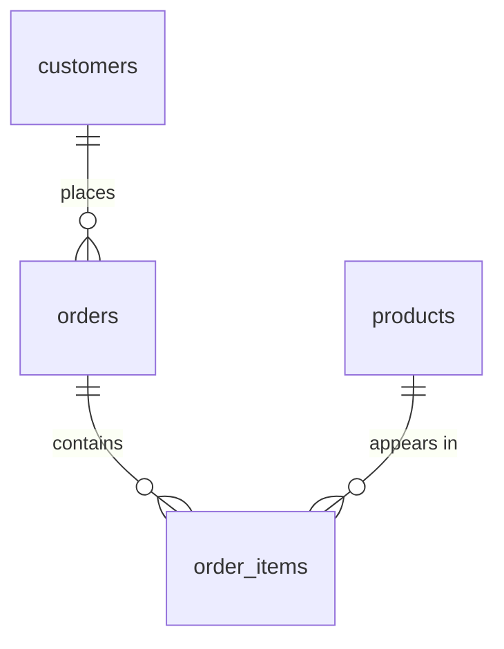

# Chapter 6: Writing and Designing

**You will learn:** how to add, change and remove data (`INSERT`, `UPDATE`, `DELETE`), how to insert-or-update in one step (upsert), how to design tables with constraints, how to organize data properly (normalization), and how to make groups of changes safe with transactions.

**Before you start:** be comfortable with Chapters 1 to 5. This is the chapter where you stop only *reading* data and start *changing* it.

> **Safety first.** Everything in this chapter modifies your practice database. That's fine: it's a sandbox. To get a clean slate at any time, re-run [`sql/schema.sql`](../sql/schema.sql). It now also removes the extra tables this chapter creates. In real databases, "undo" doesn't exist unless you planned for it, which is exactly why section 7 (transactions) matters.

## Contents
1. [INSERT: adding rows](#1-insert-adding-rows)
2. [UPDATE: changing rows](#2-update-changing-rows)
3. [DELETE: removing rows](#3-delete-removing-rows)
4. [CREATE TABLE and constraints: designing tables](#4-create-table-and-constraints-designing-tables)
5. [UPSERT: insert or update](#5-upsert-insert-or-update)
6. [Normalization: organizing data well](#6-normalization-organizing-data-well)
7. [Transactions and ACID](#7-transactions-and-acid)
8. [Chapter 6 cheat sheet](#8-chapter-6-cheat-sheet)
9. [Practice problems](#9-practice-problems)
10. [Solutions](#10-solutions)

[← Back to table of contents](../README.md) · SQL files: [`chapter-06-examples.sql`](../sql/chapter-06-examples.sql), [`chapter-06-solutions.sql`](../sql/chapter-06-solutions.sql)

> **Running the examples.** The examples in this chapter build on each other, so run them in order on a freshly reset database. Lines marked `-- ERROR DEMO` in the examples file are deliberate failures: uncomment one to see the error.

---

## 1. INSERT: adding rows

**Idea:** `INSERT` adds new rows to a table.

```
   INSERT INTO  table (col1, col2, ...)  VALUES  (val1, val2, ...);
                └─ which columns ─────┘          └─ matching values, same order ┘
```

```sql
INSERT INTO customers (name, city, signup_date) VALUES ('Gita', 'Pune', '2024-06-01');
```

Postgres replies with a **command tag**: `INSERT 0 1` means "inserted 1 row". (The `0` is a legacy field you can ignore.)

### Several rows in one statement

```sql
INSERT INTO customers (name, city, signup_date)
VALUES ('Harsh', 'Pune', '2024-06-10'),
       ('Isha',  NULL,   '2024-06-20');                  -- INSERT 0 2
```

One statement with many rows is faster than many single-row statements.

### Leaving columns out

Columns you don't mention get their **default** value, or `NULL` if there is no default. `customer_id` is a `SERIAL` column, so it fills itself in with the next number:

```sql
INSERT INTO customers (name) VALUES ('Jay');              -- city and signup_date become NULL
```

> **Always list the column names.** `INSERT INTO customers VALUES (...)` without them depends on the table's exact column order, and breaks the day someone adds a column.

### RETURNING: get the new row back

Postgres can hand back what it just stored, which is the easy way to learn a generated ID:

```sql
INSERT INTO customers (name, city) VALUES ('Kiran', 'Chennai')
RETURNING customer_id, name, city;
```

| customer_id | name | city |
|---|---|---|
| 11 | Kiran | Chennai |

`RETURNING` also works with `UPDATE` and `DELETE`. We'll use it throughout.

### INSERT ... SELECT: copy rows from a query

Instead of `VALUES`, feed `INSERT` the result of any `SELECT`. First a tiny scratch table (section 4 explains `CREATE TABLE` properly):

```sql
CREATE TABLE city_customers (name TEXT, city TEXT);

INSERT INTO city_customers
SELECT name, city FROM customers WHERE city = 'Mumbai';   -- INSERT 0 2
```

### How inserts fail

```sql
INSERT INTO customers (city) VALUES ('Pune');
-- ERROR: null value in column "name" of relation "customers" violates not-null constraint
INSERT INTO customers (name, city) VALUES ('Leela');
-- ERROR: INSERT has more target columns than expressions
```

The first breaks a `NOT NULL` rule (we never gave `name`). The second lists two columns but supplies one value.

### A SERIAL surprise: gaps in the numbers

Sequences never hand a number out twice, **even if the insert fails**. If you uncomment and run the failing `NOT NULL` insert above and then add another customer, the new id skips a number:

```sql
INSERT INTO customers (name) VALUES ('Mani') RETURNING customer_id;
```

After the failed insert, Mani gets id **13** rather than 12, because the failed attempt used up 12. (Without running the failing insert, he gets 12.) This is normal. **IDs are labels, not counters**: never assume they're gap-free.

---

## 2. UPDATE: changing rows

**Idea:** `UPDATE` changes values in **existing** rows.

```
   UPDATE  table
   SET     col1 = new_value, col2 = new_value
   WHERE   which rows to change;
```

```sql
UPDATE customers SET city = 'Pune' WHERE name = 'Jay';                                 -- UPDATE 1
UPDATE customers SET city = 'Goa', signup_date = '2024-06-15' WHERE name = 'Isha';     -- several columns at once
```

`UPDATE 1` tells you how many rows changed. **Always glance at that number**: if you expected 1 and see 6, stop.

### Using the old value

The right-hand side can use the row's current values:

```sql
UPDATE products
SET price = price * 1.10
WHERE category = 'Stationery'
RETURNING name, price;
```

| name | price |
|---|---|
| Notebook | 66.00 |
| Pen | 11.00 |

### Different changes for different rows: CASE

```sql
UPDATE employees
SET salary = CASE WHEN department = 'Engineering' THEN salary * 1.05
                  WHEN department = 'Sales'       THEN salary * 1.03
                  ELSE salary END
RETURNING name, department, salary;
```

| name | department | salary |
|---|---|---|
| Rohan | Management | 150000.00 |
| Meera | Engineering | 126000.00 |
| Karan | Engineering | 94500.00 |
| Sneha | Engineering | 94500.00 |
| Imran | Sales | 72100.00 |
| Priya | Sales | 66950.00 |
| Tanvi | HR | 60000.00 |

(No `WHERE`, so every row is processed, and `CASE` decides the new value for each. Rows that fall to `ELSE` keep their salary.)

### UPDATE ... FROM: change rows using another table

When the condition lives in another table, join it in with `FROM`:

```sql
-- cancel pending orders belonging to customers with no city on file
UPDATE orders o
SET status = 'cancelled'
FROM customers c
WHERE c.customer_id = o.customer_id
  AND c.city IS NULL
  AND o.status = 'pending'
RETURNING o.order_id, c.name, o.status;
```

| order_id | name | status |
|---|---|---|
| 5 | Dev | cancelled |

It works like a join: the `WHERE` ties each order to its customer. Only Dev (no city) has a pending order.

### The #1 UPDATE disaster: forgetting WHERE

```text
UPDATE products SET price = 0;      -- no WHERE: EVERY row changes
```

Postgres won't stop you. Here is the safe habit: **do it inside a transaction and look before you commit** (section 7 explains fully):

```sql
BEGIN;                                                    -- start a safety bubble
UPDATE products SET price = 0;                            -- UPDATE 6   (six! that's wrong!)
SELECT name, price FROM products ORDER BY product_id;     -- everything is 0.00. Oops.
ROLLBACK;                                                 -- undo everything since BEGIN
SELECT name, price FROM products ORDER BY product_id;     -- prices are back
```

**Habits that prevent disasters**
1. Write the `WHERE` first, or run it as a `SELECT` first to see exactly which rows match.
2. Check the `UPDATE n` count against what you expected.
3. For anything risky, wrap it in `BEGIN` ... check ... `COMMIT` (or `ROLLBACK`).

---

## 3. DELETE: removing rows

```
   DELETE FROM table WHERE which rows to remove;
```

```sql
DELETE FROM customers WHERE name = 'Mani';                -- DELETE 1
```

Same danger as `UPDATE`: no `WHERE` means **every row goes**. Same habits apply.

### Foreign keys protect you

```sql
DELETE FROM customers WHERE name = 'Asha';
-- ERROR: update or delete on table "customers" violates foreign key constraint "orders_customer_id_fkey" on table "orders"
-- DETAIL: Key (customer_id)=(1) is still referenced from table "orders".
```

Asha has orders, so deleting her would leave orders pointing at nobody. Postgres refuses. (Section 4 shows how `ON DELETE CASCADE` changes this.)

### Deleting based on another table

Use a subquery (Chapter 4):

```sql
-- remove the line items of cancelled orders
DELETE FROM order_items
WHERE order_id IN (SELECT order_id FROM orders WHERE status = 'cancelled')
RETURNING *;
```

| order_item_id | order_id | product_id | quantity |
|---|---|---|---|
| 5 | 3 | 2 | 1 |
| 7 | 5 | 3 | 1 |

(Order 3 was cancelled originally. Order 5 became cancelled in section 2.) `RETURNING *` shows exactly what was removed, a good audit trail.

### DELETE vs TRUNCATE vs DROP

Three ways to get rid of data, at three levels:

```
                    DELETE                  TRUNCATE                 DROP TABLE
   removes          chosen rows (WHERE)     ALL rows, fast           the whole table
   table survives?  yes                     yes (empty)              NO
   WHERE allowed?   yes                     no                       n/a
   speed on big     slower (row by row)     very fast                very fast
   tables
   can roll back?   yes                     yes (in Postgres)        yes (in Postgres)
   resets ID        no                      only with                n/a
   counter?                                 RESTART IDENTITY
```

```sql
DELETE FROM city_customers WHERE name = 'Asha';           -- DELETE 1: one row gone, one left

BEGIN;
TRUNCATE city_customers;                                  -- empties the table instantly
SELECT COUNT(*) FROM city_customers;                      -- 0
ROLLBACK;                                                 -- Postgres lets you undo even TRUNCATE
SELECT COUNT(*) FROM city_customers;                      -- 1 again

TRUNCATE city_customers;                                  -- empty it for real
DROP TABLE city_customers;                                -- remove the table itself
```

> **Rule of thumb:** `DELETE` to remove *some* rows, `TRUNCATE` to empty a table, `DROP` to remove the table. (Not every database lets you roll back `TRUNCATE` and `DROP`. Postgres does, but don't rely on it elsewhere.)

### Removing duplicates (Chapter 5 meets Chapter 6)

Here's a table with duplicate emails. We'll keep only the newest row per email, and **move the old ones to an archive table** in one statement:

```sql
CREATE TABLE emails (id INT PRIMARY KEY, email TEXT NOT NULL, created_at DATE NOT NULL);
INSERT INTO emails VALUES
    (1, 'a@x.com', '2024-01-01'), (2, 'a@x.com', '2024-02-01'), (3, 'b@x.com', '2024-01-15'),
    (4, 'a@x.com', '2024-03-01'), (5, 'c@x.com', '2024-01-20'), (6, 'b@x.com', '2024-01-16');

CREATE TABLE emails_archive (LIKE emails);                -- same columns as emails, empty

WITH dupes AS (
    SELECT id
    FROM (SELECT id, ROW_NUMBER() OVER (PARTITION BY email ORDER BY created_at DESC) AS rn
          FROM emails) AS t
    WHERE rn > 1                                          -- everything except the newest per email
),
moved AS (
    DELETE FROM emails
    WHERE id IN (SELECT id FROM dupes)
    RETURNING *                                           -- hand the deleted rows to the next step
)
INSERT INTO emails_archive SELECT * FROM moved;           -- INSERT 0 3

SELECT * FROM emails ORDER BY id;                         -- ids 4, 5, 6
SELECT * FROM emails_archive ORDER BY id;                 -- ids 1, 2, 3
```

```
   emails (before)          rn            emails (after)      emails_archive
   1  a@x.com  Jan          3  ──┐
   2  a@x.com  Feb          2  ──┼───────────────────────────►  1, 2, 3   (the old duplicates)
   3  b@x.com  Jan 15       2  ──┘
   4  a@x.com  Mar          1  ───► kept
   5  c@x.com  Jan 20       1  ───► kept                        4, 5, 6 stay
   6  b@x.com  Jan 16       1  ───► kept
```

This is a **data-modifying CTE**: a `DELETE ... RETURNING` inside a `WITH`, whose output feeds an `INSERT`. Delete and archive happen as one atomic statement.

---

## 4. CREATE TABLE and constraints: designing tables

**Idea:** a table is defined by its columns **and the rules** that keep its data trustworthy. Rules (constraints) are enforced by the database itself, so every app and script that touches the table must obey them.

```sql
CREATE TABLE product_stock (
    product_id    INT PRIMARY KEY REFERENCES products(product_id) ON DELETE CASCADE,
    quantity      INT NOT NULL DEFAULT 0 CHECK (quantity >= 0),
    last_updated  TIMESTAMP NOT NULL DEFAULT NOW()
);
```

```
   column name   type   column-level rules
   ─────────────────────────────────────────────────────────────────────
   product_id    INT    PRIMARY KEY  + a link to products  + cascade on delete
   quantity      INT    cannot be NULL, defaults to 0, can't go negative
   last_updated  TIMESTAMP  cannot be NULL, defaults to "now"
```

### The constraints

| Constraint | What it guarantees | Example |
|---|---|---|
| `PRIMARY KEY` | each row is uniquely identifiable (unique and not NULL) | `product_id INT PRIMARY KEY` |
| `NOT NULL` | the column always has a value | `name TEXT NOT NULL` |
| `UNIQUE` | no two rows share this value (NULLs allowed) | `email TEXT UNIQUE` |
| `CHECK` | a custom rule on the row's values | `CHECK (rating BETWEEN 1 AND 5)` |
| `DEFAULT` | the value used when none is given | `DEFAULT NOW()` |
| `FOREIGN KEY` | the value must exist in another table | `REFERENCES products(product_id)` |

### A fuller example with every kind

```sql
CREATE TABLE reviews (
    review_id    INT GENERATED ALWAYS AS IDENTITY PRIMARY KEY,
    customer_id  INT NOT NULL REFERENCES customers(customer_id),
    product_id   INT NOT NULL REFERENCES products(product_id),
    rating       INT NOT NULL CHECK (rating BETWEEN 1 AND 5),
    comment      TEXT,
    created_at   TIMESTAMPTZ NOT NULL DEFAULT NOW(),
    UNIQUE (customer_id, product_id)            -- one review per customer per product
);
```

Two new ideas:

- **`GENERATED ALWAYS AS IDENTITY`** is the modern, standard way to auto-number a column. (`SERIAL`, used in our shop tables, is the older Postgres shorthand. Both work; prefer `IDENTITY` for new tables.)
- **A table-level `UNIQUE (a, b)`** makes the **combination** unique, not each column alone. Customer 1 can review product 1 and product 2, and product 1 can be reviewed by customers 1 and 2, but customer 1 can't review product 1 twice.

### Watching the rules enforce themselves

```sql
INSERT INTO reviews (customer_id, product_id, rating, comment) VALUES (1, 1, 5, 'Great laptop');     -- works
```

Now try to break each rule (uncomment these in the examples file to see them):

```sql
INSERT INTO reviews (customer_id, product_id, rating, comment) VALUES (1, 1, 4, 'Second thoughts');
-- ERROR: duplicate key value violates unique constraint "reviews_customer_id_product_id_key"
INSERT INTO reviews (customer_id, product_id, rating, comment) VALUES (2, 1, 6, 'Too good');
-- ERROR: new row for relation "reviews" violates check constraint "reviews_rating_check"
INSERT INTO reviews (customer_id, product_id, rating, comment) VALUES (999, 1, 3, 'Ghost');
-- ERROR: insert or update on table "reviews" violates foreign key constraint "reviews_customer_id_fkey"
INSERT INTO reviews (customer_id, product_id, comment) VALUES (2, 1, 'No rating');
-- ERROR: null value in column "rating" of relation "reviews" violates not-null constraint
INSERT INTO reviews (review_id, customer_id, product_id, rating) VALUES (50, 2, 1, 3);
-- ERROR: cannot insert a non-DEFAULT value into column "review_id"
```

| Rule broken | Error message starts with |
|---|---|
| `UNIQUE` | duplicate key value violates unique constraint |
| `CHECK` | new row ... violates check constraint |
| `FOREIGN KEY` | ... violates foreign key constraint |
| `NOT NULL` | null value in column ... violates not-null constraint |
| `GENERATED ALWAYS` | cannot insert a non-DEFAULT value into column |

A normal insert fills in `review_id` and `created_at` for you:

```sql
INSERT INTO reviews (customer_id, product_id, rating) VALUES (2, 1, 4)
RETURNING review_id, created_at IS NOT NULL AS has_timestamp;
```

> **Note:** the failed attempts above each used up an identity number (like the `SERIAL` gap in section 1), so this row's `review_id` will be higher than 2 if you ran them.

**Name your important constraints** if you want readable error messages and easy changes: `CONSTRAINT rating_range CHECK (rating BETWEEN 1 AND 5)`. If you don't, Postgres invents names like `reviews_rating_check`.

### Choosing types sensibly

| Data | Use | Avoid |
|---|---|---|
| Money | `NUMERIC(10,2)` | `FLOAT` (rounding errors) |
| Text | `TEXT` (or `VARCHAR(n)` for a real length limit) | |
| Date only | `DATE` | text like `'2024-01-15'` |
| Moment in time | `TIMESTAMPTZ` | `TIMESTAMP` when time zones matter |
| Yes/no | `BOOLEAN` | `'Y'`/`'N'` or 0/1 |
| Whole numbers | `INT` (`BIGINT` if huge) | |

### Composite primary keys

A key can span several columns, when only the **combination** is unique. A junction table is the classic case:

```text
   CREATE TABLE order_items_example (
       order_id    INT REFERENCES orders(order_id),
       product_id  INT REFERENCES products(product_id),
       quantity    INT NOT NULL,
       PRIMARY KEY (order_id, product_id)         -- one line per product per order
   );
```

### ALTER TABLE: changing a table after creation

```sql
ALTER TABLE reviews ADD COLUMN helpful_votes INT NOT NULL DEFAULT 0;             -- add a column
ALTER TABLE reviews RENAME COLUMN comment TO review_text;                        -- rename a column
ALTER TABLE reviews ADD CONSTRAINT helpful_nonneg CHECK (helpful_votes >= 0);    -- add a rule
ALTER TABLE reviews ALTER COLUMN rating TYPE SMALLINT;                           -- change a type
ALTER TABLE reviews DROP COLUMN helpful_votes;                                   -- remove a column (and its constraint)
```

Other forms: `RENAME TO new_name` (rename the table), `ALTER COLUMN x SET NOT NULL`, `ALTER COLUMN x SET DEFAULT ...`, `DROP CONSTRAINT name`.

Constraints are checked against existing data when you add them, and against future data forever after. For example, with `helpful_nonneg` in place:

```sql
UPDATE reviews SET helpful_votes = -1 WHERE review_id = 1;
-- ERROR: new row for relation "reviews" violates check constraint "helpful_nonneg"
```

### See a table's definition

In `psql`, the command `\d reviews` prints the table's structure (other clients have a "properties" or "DDL" view). It looks like this:

```text
                                    Table "public.reviews"
   Column    |           Type           | Nullable |           Default
-------------+--------------------------+----------+------------------------------
 review_id   | integer                  | not null | generated always as identity
 customer_id | integer                  | not null |
 product_id  | integer                  | not null |
 rating      | smallint                 | not null |
 review_text | text                     |          |
 created_at  | timestamp with time zone | not null | now()
Indexes:
    "reviews_pkey" PRIMARY KEY, btree (review_id)
    "reviews_customer_id_product_id_key" UNIQUE CONSTRAINT, btree (customer_id, product_id)
Check constraints:
    "reviews_rating_check" CHECK (rating >= 1 AND rating <= 5)
Foreign-key constraints:
    "reviews_customer_id_fkey" FOREIGN KEY (customer_id) REFERENCES customers(customer_id)
    "reviews_product_id_fkey" FOREIGN KEY (product_id) REFERENCES products(product_id)
```

### Foreign key actions: what happens to the children?

When you delete a parent row, the foreign key's `ON DELETE` setting decides what happens to rows pointing at it:

| Setting | When the parent is deleted... |
|---|---|
| `NO ACTION` / `RESTRICT` (default) | the delete is **refused** while children exist |
| `CASCADE` | the children are **deleted too** |
| `SET NULL` | the children's foreign key becomes `NULL` |
| `SET DEFAULT` | the children's foreign key becomes its default |

We gave `product_stock` an `ON DELETE CASCADE`. Watch it work with a throwaway product:

```sql
INSERT INTO products (name, category, price) VALUES ('Test Gadget', 'Electronics', 999);

INSERT INTO product_stock (product_id, quantity)
SELECT product_id, 5 FROM products WHERE name = 'Test Gadget';       -- stock row for the gadget

DELETE FROM products WHERE name = 'Test Gadget';                     -- DELETE 1 ... and its stock row goes too
SELECT COUNT(*) FROM product_stock;                                  -- 0
```

Compare with the default behaviour on `order_items`, which has no cascade:

```sql
DELETE FROM products WHERE name = 'Laptop';
-- ERROR: update or delete on table "products" violates foreign key constraint "order_items_product_id_fkey" on table "order_items"
```

> **Choose deliberately.** `CASCADE` is convenient for "owned" data (a product's stock row means nothing without the product), but dangerous where the children matter on their own (deleting a customer should *not* silently erase their order history).

### Copying a table: CREATE TABLE AS

```sql
CREATE TABLE electronics_copy AS
SELECT * FROM products WHERE category = 'Electronics';

SELECT COUNT(*) FROM electronics_copy;                    -- 3
```

`CREATE TABLE AS` copies the **data and column types**, but **not** the constraints, keys or defaults. To copy the structure with its rules, use `CREATE TABLE new (LIKE old INCLUDING ALL)`.

### DROP TABLE

```sql
DROP TABLE electronics_copy;
DROP TABLE IF EXISTS electronics_copy;                    -- no error if it's already gone
```

`DROP TABLE x CASCADE` also removes anything that depends on `x` (foreign keys, views). Use with care.

---

## 5. UPSERT: insert or update

**Problem:** "Add this row, but if it already exists, update it instead." Doing it by hand (check, then insert or update) is slow and breaks when two users act at once.

**Solution:** `INSERT ... ON CONFLICT`. The name **upsert** = update + insert.

It needs a **unique rule** to decide what "already exists" means: a primary key or `UNIQUE` constraint.

First, some stock rows:

```sql
INSERT INTO product_stock (product_id, quantity) VALUES (1, 10), (2, 25);         -- INSERT 0 2
```

### Option 1: DO NOTHING (skip duplicates)

```sql
INSERT INTO product_stock (product_id, quantity) VALUES (1, 99)
ON CONFLICT (product_id) DO NOTHING;                                              -- INSERT 0 0 (skipped)
```

Without the `ON CONFLICT`, that same insert fails with `duplicate key value violates unique constraint "product_stock_pkey"`.

### Option 2: DO UPDATE (insert or update)

```sql
INSERT INTO product_stock (product_id, quantity)
VALUES (1, 5), (3, 40)
ON CONFLICT (product_id)
DO UPDATE SET quantity     = product_stock.quantity + EXCLUDED.quantity,
              last_updated = NOW()
RETURNING product_id, quantity;
```

| product_id | quantity |
|---|---|
| 1 | 15 |
| 3 | 40 |

```
   VALUES (1, 5)  ──► product 1 already exists?  YES ──► conflict ──► UPDATE: 10 + 5 = 15
   VALUES (3, 40) ──► product 3 already exists?  NO  ──► plain INSERT: quantity 40
```

Two names to learn inside `DO UPDATE`:

- `product_stock.quantity` is the **existing** row's value.
- `EXCLUDED.quantity` is the **new value you tried to insert** (the "excluded" row).

So `product_stock.quantity + EXCLUDED.quantity` means "old stock plus the incoming amount".

```sql
SELECT product_id, quantity FROM product_stock ORDER BY product_id;               -- 1: 15, 2: 25, 3: 40
```

### Upsert on a composite UNIQUE

A customer changes their mind about a review. `(customer_id, product_id)` is unique, so:

```sql
INSERT INTO reviews (customer_id, product_id, rating, review_text)
VALUES (1, 1, 3, 'Changed my mind')
ON CONFLICT (customer_id, product_id)
DO UPDATE SET rating = EXCLUDED.rating, review_text = EXCLUDED.review_text
RETURNING review_id, rating, review_text;
```

| review_id | rating | review_text |
|---|---|---|
| 1 | 3 | Changed my mind |

The original review (id 1) is updated in place instead of failing or duplicating.

### Mistakes with ON CONFLICT

```sql
INSERT INTO product_stock (product_id, quantity) VALUES (1, 5) ON CONFLICT (quantity) DO NOTHING;
-- ERROR: there is no unique or exclusion constraint matching the ON CONFLICT specification
INSERT INTO product_stock (product_id, quantity) VALUES (1, 5) ON CONFLICT DO UPDATE SET quantity = 0;
-- ERROR: ON CONFLICT DO UPDATE requires inference specification or constraint name
```

The conflict target must be a column (or set of columns) with a unique or primary-key constraint. And `DO UPDATE` always needs a target, so Postgres knows which conflict you mean.

> **Newer Postgres:** version 15 added a `MERGE` statement, a more general (and more verbose) way to do insert-or-update-or-delete in one command. `ON CONFLICT` remains the everyday upsert tool.

---

## 6. Normalization: organizing data well

**Idea:** normalization is the discipline of storing **each fact once, in the right place**, so your data can't contradict itself. It's usually described in "normal forms" (1NF, 2NF, 3NF), each fixing a specific kind of mess.

### Why bother? Meet a messy table

Here's an order table with everything crammed into one place:

```sql
CREATE TABLE orders_flat (
    order_id       INT,
    customer_name  TEXT,
    customer_city  TEXT,
    product_name   TEXT,
    product_price  NUMERIC(10,2),
    quantity       INT
);

INSERT INTO orders_flat VALUES
    (1, 'Asha',   'Mumbai', 'Laptop',     55000, 1),
    (1, 'Asha',   'Mumbai', 'Headphones',  2500, 2),
    (2, 'Asha',   'Mumbai', 'Notebook',      60, 10),
    (3, 'Ben',    'Delhi',  'Phone',      30000, 1),
    (4, 'Chitra', 'Mumbai', 'Headphones',  2500, 1);
```

Asha's city is stored three times, and the Headphones price twice. This causes three kinds of trouble, called **anomalies**:

| Anomaly | Problem | Example here |
|---|---|---|
| **Update** | change a fact in one place and miss another, so the data contradicts itself | Asha moves to Pune; you update one row only |
| **Insert** | can't record a fact without an unrelated one | can't add a new product until someone orders it |
| **Delete** | deleting one fact accidentally destroys another | deleting Ben's only order erases the fact that he lives in Delhi, and that the Phone costs 30000 |

Watch the update anomaly happen:

```sql
UPDATE orders_flat SET customer_city = 'Pune' WHERE order_id = 1 AND product_name = 'Laptop';

SELECT DISTINCT customer_name, customer_city FROM orders_flat ORDER BY 1, 2;
```

| customer_name | customer_city |
|---|---|
| Asha | Mumbai |
| Asha | **Pune** |
| Ben | Delhi |
| Chitra | Mumbai |

Where does Asha live? The table now disagrees with itself. Normalization prevents this.

### The normal forms, step by step

```
   UNNORMALIZED                    1NF                          2NF                         3NF
   ───────────────                 ──────────                   ──────────                  ──────────
   order, customer,   ──────────►  one value per cell, ───────► no PARTIAL dependency ─────► no TRANSITIVE dependency
   "Laptop, Phone"                 no repeating groups          on part of a key            (non-key depends on non-key)
   (lists in a cell)               and a unique key
```

#### 1NF: every cell holds one atomic value

- No lists in a cell (`'Laptop, Headphones'` is **not** allowed).
- No repeating columns (`product1`, `product2`, `product3`).
- Every row is uniquely identifiable (there's a key).

`orders_flat` already satisfies 1NF: one product per row, and `(order_id, product_name)` identifies each row. But it still has anomalies, so we go further.

#### 2NF: every non-key column depends on the **whole** key

This matters when the key has more than one column. Our key is `(order_id, product_name)`. Ask of each other column: *does it depend on the whole key, or only part of it?*

```
   key = (order_id, product_name)

   customer_name, customer_city  ──► depend only on order_id             ✘ partial dependency
   product_price                 ──► depends only on product_name        ✘ partial dependency
   quantity                      ──► depends on BOTH (this order, this product)   ✔
```

**Fix:** move the partially-dependent columns into their own tables, keyed by what they truly depend on.

```
   orders(order_id, customer_name, customer_city)
   products(product_name, product_price)
   order_items(order_id, product_name, quantity)
```

#### 3NF: no non-key column depends on another non-key column

Look at `orders`: `customer_city` depends on `customer_name`, not directly on `order_id`. The chain is `order_id → customer_name → customer_city`. That's a **transitive dependency**.

**Fix:** give customers their own table.

```
   customers(customer_id, name, city)
   orders(order_id, customer_id)
   products(product_id, name, price)
   order_items(order_id, product_id, quantity)
```

Now compare that with our shop database. It's exactly this design:



A handy way to remember all three:

> Every non-key column must depend on **the key** (1NF), **the whole key** (2NF), **and nothing but the key** (3NF).

### The payoff

| Anomaly | In the normalized design |
|---|---|
| Update | Asha's city lives in **one** row of `customers`. Change it once. |
| Insert | Add a product to `products` without any order. |
| Delete | Deleting an order doesn't erase the customer or the product. |

### When to break the rules: denormalization

Normalized data is clean but needs **joins** to reassemble. Sometimes teams deliberately store redundant copies for speed (for example, keeping an order's `total` on the order row, or reporting tables). That's a conscious trade-off: faster reads, but now **you** must keep the copies in sync. The usual advice: **design to 3NF first, and denormalize only when you can show a real performance need.**

---

## 7. Transactions and ACID

**Idea:** a **transaction** groups several statements into **one all-or-nothing unit**. Either every statement succeeds and is saved together, or none of them take effect.

**Why:** moving money. Subtracting 200 from Asha and adding 200 to Ben are two separate `UPDATE`s. If the system crashes between them, 200 vanishes from the universe. A transaction makes the pair indivisible.

```sql
CREATE TABLE accounts (
    account_id  INT PRIMARY KEY,
    owner       TEXT NOT NULL,
    balance     NUMERIC(12,2) NOT NULL CHECK (balance >= 0)
);

INSERT INTO accounts VALUES (1, 'Asha', 1000), (2, 'Ben', 500);
```

### BEGIN, COMMIT, ROLLBACK

| Command | Meaning |
|---|---|
| `BEGIN` | start a transaction |
| `COMMIT` | make everything since `BEGIN` permanent |
| `ROLLBACK` | cancel everything since `BEGIN`, as if it never happened |

```sql
BEGIN;
UPDATE accounts SET balance = balance - 200 WHERE account_id = 1;
UPDATE accounts SET balance = balance + 200 WHERE account_id = 2;
COMMIT;

SELECT * FROM accounts ORDER BY account_id;
```

| account_id | owner | balance |
|---|---|---|
| 1 | Asha | 800.00 |
| 2 | Ben | 700.00 |

```
   BEGIN ───► [ debit Asha ] ───► [ credit Ben ] ───► COMMIT    both saved together
                                        │
                                        └── something fails? ──► ROLLBACK   neither saved
```

Changing your mind part-way:

```sql
BEGIN;
UPDATE accounts SET balance = balance - 100 WHERE account_id = 1;
SELECT balance FROM accounts WHERE account_id = 1;        -- 700.00 (visible inside YOUR transaction)
ROLLBACK;
SELECT balance FROM accounts WHERE account_id = 1;        -- 800.00 (undone)
```

### Autocommit: you're always in a transaction

Outside an explicit `BEGIN`, **every statement is its own tiny transaction** that commits automatically. That's why a lone `UPDATE` is permanent the moment it finishes. `BEGIN` switches that off until you `COMMIT` or `ROLLBACK`. (Some GUI clients, such as DataGrip, have an **Auto / Manual** transaction mode switch. In Manual mode you must press Commit yourself.)

### When something fails inside a transaction

Our `accounts` table has `CHECK (balance >= 0)`. Try to transfer more than Asha has. This is what a session looks like (shown as a transcript, since the middle step fails):

```text
BEGIN;
UPDATE accounts SET balance = balance - 5000 WHERE account_id = 1;
ERROR:  new row for relation "accounts" violates check constraint "accounts_balance_check"

UPDATE accounts SET balance = balance + 5000 WHERE account_id = 2;
ERROR:  current transaction is aborted, commands ignored until end of transaction block

COMMIT;
ROLLBACK                       <- Postgres turned your COMMIT into a ROLLBACK
```

Once any statement fails, the transaction is **poisoned**: everything after it is ignored until you end it, and even `COMMIT` becomes `ROLLBACK`. Afterwards, both balances are exactly as they were. Ben never got the 5000 that Asha never lost. That is atomicity at work.

### SAVEPOINT: a partial undo

A savepoint is a bookmark inside a transaction. You can roll back to it without cancelling everything:

```sql
BEGIN;
INSERT INTO accounts VALUES (3, 'Chitra', 100);
SAVEPOINT after_chitra;
INSERT INTO accounts VALUES (4, 'Dev', 200);
ROLLBACK TO SAVEPOINT after_chitra;                       -- undo only Dev
COMMIT;                                                   -- Chitra is saved

SELECT * FROM accounts ORDER BY account_id;               -- accounts 1, 2 and 3 (no Dev)
```

### Even structure changes can be rolled back

Many databases can't undo `CREATE TABLE`. Postgres can:

```sql
BEGIN;
CREATE TABLE temp_demo (x INT);
ROLLBACK;
SELECT to_regclass('temp_demo') AS exists_now;            -- NULL: the table never came to exist
```

This makes risky schema changes much safer in Postgres: wrap them in a transaction and check before committing.

### ACID: the four promises

Databases that support transactions promise four properties, remembered as **ACID**:

```
   A  Atomicity     all or nothing          the transfer happens completely, or not at all
   C  Consistency   rules always hold       constraints (CHECK, FOREIGN KEY...) are never left violated
   I  Isolation     transactions don't      other users never see your half-finished work
                    trample each other
   D  Durability    committed = permanent   once COMMIT succeeds, it survives a crash
```

| Property | Plain-English meaning | Bank-transfer example | What provides it |
|---|---|---|---|
| **Atomicity** | a transaction is indivisible | debit and credit both happen, or neither | rollback |
| **Consistency** | data always satisfies its rules | balance can never go negative | constraints |
| **Isolation** | concurrent transactions don't see each other's unfinished changes | Ben's transaction doesn't see Asha's half-done transfer | MVCC / locking |
| **Durability** | committed work is never lost | power cut right after `COMMIT`: the transfer is still there | write-ahead log (WAL) |

### A glimpse of isolation: two people at once

```
   Session A                              Session B
   ─────────                              ─────────
   BEGIN;
   UPDATE accounts
      SET balance = 0
    WHERE account_id = 1;
                                          SELECT balance FROM accounts
                                           WHERE account_id = 1;   ──►  800.00  (still the OLD value:
                                                                               A hasn't committed)
   COMMIT;
                                          SELECT balance ...        ──►  0.00    (now it's visible)
```

By default, PostgreSQL uses the **READ COMMITTED** isolation level: you only ever see data that has been committed, never someone's work in progress ("no dirty reads"). If Session B tried to *update* the same row while A's transaction is open, B would **wait** for A to finish. Postgres has stricter levels too (`REPEATABLE READ`, `SERIALIZABLE`) for situations that need stronger guarantees. That's a topic for a later study, and not needed for everyday work.

### Good transaction habits

1. **Keep transactions short.** Open locks and old snapshots hurt everyone else.
2. **Group related changes**: anything that must succeed together belongs in one transaction.
3. **Test risky `UPDATE`/`DELETE` statements** inside `BEGIN`, check the row counts and results, then `COMMIT` or `ROLLBACK`.

---

## 8. Chapter 6 cheat sheet

```sql
INSERT INTO t (a, b) VALUES (1, 'x'), (2, 'y') RETURNING *;
INSERT INTO t (a, b) SELECT ...;
UPDATE t SET a = a + 1 WHERE ... RETURNING *;
UPDATE t SET ... FROM other WHERE t.id = other.id AND ...;
DELETE FROM t WHERE ... RETURNING *;
INSERT INTO t (id, qty) VALUES (1, 5)
    ON CONFLICT (id) DO UPDATE SET qty = t.qty + EXCLUDED.qty;
BEGIN;  ...  COMMIT;   -- or ROLLBACK;
```

| I want to... | Use |
|---|---|
| Add rows | `INSERT ... VALUES` / `INSERT ... SELECT` |
| Get generated IDs back | `RETURNING` |
| Change rows | `UPDATE ... SET ... WHERE` |
| Update using another table | `UPDATE ... FROM` |
| Remove some rows / all rows / the table | `DELETE` / `TRUNCATE` / `DROP TABLE` |
| Insert, or update if it exists | `INSERT ... ON CONFLICT (...) DO UPDATE` |
| Skip rows that already exist | `ON CONFLICT (...) DO NOTHING` |
| Define rules for data | `PRIMARY KEY`, `NOT NULL`, `UNIQUE`, `CHECK`, `DEFAULT`, `FOREIGN KEY` |
| Change a table's shape | `ALTER TABLE ... ADD/DROP/RENAME/ALTER COLUMN` |
| Make several changes all-or-nothing | `BEGIN` ... `COMMIT` / `ROLLBACK` |
| Partial undo inside a transaction | `SAVEPOINT` / `ROLLBACK TO SAVEPOINT` |

**Things never to forget**
1. `UPDATE` and `DELETE` without `WHERE` hit **every row**. Preview with `SELECT`, check the row count, use a transaction.
2. Always list column names in `INSERT`.
3. Constraints defend your data: `NOT NULL`, `UNIQUE`, `CHECK`, `FOREIGN KEY`. Let the database enforce the rules.
4. `ON CONFLICT` needs a unique constraint to target; `EXCLUDED` is the incoming row.
5. Normalize: every non-key column depends on the key, the whole key, and nothing but the key.
6. A transaction is all-or-nothing. After an error inside one, only `ROLLBACK` helps.
7. ID numbers can have gaps. They are labels, not counters.

---

## 9. Practice problems

Reset the database first (re-run `sql/schema.sql`), then work through these **in order**: later problems build on earlier ones. Preview every `UPDATE` and `DELETE` with a `SELECT` before running it.

### Easy
1. Insert a new customer, Gita, from Pune, who signed up on `2024-06-01`. Return her new `customer_id`.
2. Insert two products in one statement: `Mouse` (Electronics, 800) and `Stapler` (Stationery, 150).
3. Change Gita's city to `Hyderabad`.
4. Increase the price of every Stationery product by 10%, showing the new prices.
5. Delete the customer Gita.
6. Delete the product `Stapler`.

### Medium
7. Create a table `wishlist` with: an auto-generated primary key, a required `customer_id` and `product_id` (both foreign keys), an `added_on` date defaulting to today, and a rule that a customer can't wishlist the same product twice. Insert `(1, 2)`, then try inserting it again. What error do you get?
8. Add a column `priority` to `wishlist`: whole number, required, default 1, only allowed to be 1, 2 or 3.
9. Write an upsert: insert `(customer 1, product 2)` into `wishlist` with priority 3, but if the pair exists, update its priority to 3 instead.
10. Mark as `delivered` every `pending` order placed before `2024-07-02`, returning the changed rows.
11. Delete the `order_items` that belong to cancelled orders, returning the deleted rows.
12. Create a table `electronics_copy` from the Electronics products with `CREATE TABLE AS`, and count its rows. (How many do you expect, given problem 2?)
13. Give every Engineering employee a 5% raise and show their new salaries.

### Challenging
14. Create and fill this table, then transfer 300 from Asha's account to Ben's inside a transaction:
    ```sql
    CREATE TABLE accounts (account_id INT PRIMARY KEY, owner TEXT NOT NULL,
                           balance NUMERIC(12,2) NOT NULL CHECK (balance >= 0));
    INSERT INTO accounts VALUES (1, 'Asha', 1000), (2, 'Ben', 500);
    ```
15. Asha now tries to transfer 5000 to Ben. What happens, why, and what are the balances afterwards? Write the transaction and explain each step.
16. Using `wishlist`, write a transaction that inserts `(2, 1)` and `(2, 3)`, sets a savepoint, inserts `(3, 1)`, rolls back to the savepoint, then commits. Which rows remain?
17. Here is a table with duplicate emails. Keep only the newest row per email, and move the removed rows to an archive table, in a **single statement**:
    ```sql
    CREATE TABLE emails (id INT PRIMARY KEY, email TEXT NOT NULL, created_at DATE NOT NULL);
    INSERT INTO emails VALUES (1,'a@x.com','2024-01-01'), (2,'a@x.com','2024-02-01'), (3,'b@x.com','2024-01-15'),
                              (4,'a@x.com','2024-03-01'), (5,'c@x.com','2024-01-20'), (6,'b@x.com','2024-01-16');
    CREATE TABLE emails_archive (LIKE emails);
    ```
18. Normalize this flat table to 3NF. Say which normal forms it breaks, then write the `CREATE TABLE` statements (with keys and constraints) and `INSERT ... SELECT` statements to fill the new tables from it. Prefix the new tables with `flat_` so they don't clash with the shop tables.
    ```sql
    CREATE TABLE orders_flat (order_id INT, customer_name TEXT, customer_city TEXT,
                              product_name TEXT, product_price NUMERIC(10,2), quantity INT);
    INSERT INTO orders_flat VALUES
        (1,'Asha','Mumbai','Laptop',55000,1), (1,'Asha','Mumbai','Headphones',2500,2),
        (2,'Asha','Mumbai','Notebook',60,10), (3,'Ben','Delhi','Phone',30000,1),
        (4,'Chitra','Mumbai','Headphones',2500,1);
    ```
19. Predict the error for each statement (don't run them first), given the tables from earlier problems:
    ```sql
    -- (a)
    INSERT INTO accounts VALUES (1, 'Zed', 50);
    -- (b)
    INSERT INTO accounts VALUES (9, 'Zed', -5);
    -- (c)
    INSERT INTO wishlist (customer_id, product_id) VALUES (999, 1);
    -- (d)
    DELETE FROM customers WHERE customer_id = 1;
    ```
20. Each of these has a mistake. Explain it and fix it:
    ```sql
    -- (a) goal: give only Priya a raise to 70000
    UPDATE employees SET salary = 70000;
    -- (b) goal: add a customer named Leela from Surat
    INSERT INTO customers (name, city) VALUES ('Leela');
    -- (c) goal: if (customer 1, product 2) is already wishlisted, raise its priority to 2
    INSERT INTO wishlist (customer_id, product_id, priority) VALUES (1, 2, 2)
    ON CONFLICT (priority) DO UPDATE SET priority = 2;
    ```

**Self-check: you've mastered Chapter 6 when you can explain, without notes:**
- the dangers of `UPDATE`/`DELETE` without `WHERE`, and how to protect yourself,
- the difference between `DELETE`, `TRUNCATE` and `DROP`,
- what each constraint does and what error each produces,
- how `ON CONFLICT DO UPDATE` and `EXCLUDED` work,
- why `orders_flat` breaks 2NF and 3NF, and how splitting it fixes the anomalies,
- what ACID stands for and what `BEGIN`, `COMMIT`, `ROLLBACK` and `SAVEPOINT` do.

---

## 10. Solutions

<details>
<summary><b>Click to reveal (try first!)</b></summary>

```sql
-- 1
INSERT INTO customers (name, city, signup_date) VALUES ('Gita', 'Pune', '2024-06-01')
RETURNING customer_id;

-- 2
INSERT INTO products (name, category, price)
VALUES ('Mouse', 'Electronics', 800), ('Stapler', 'Stationery', 150);

-- 3
UPDATE customers SET city = 'Hyderabad' WHERE name = 'Gita';

-- 4
UPDATE products SET price = price * 1.10 WHERE category = 'Stationery' RETURNING name, price;

-- 5
DELETE FROM customers WHERE name = 'Gita';

-- 6
DELETE FROM products WHERE name = 'Stapler';

-- 7
CREATE TABLE wishlist (
    wishlist_id  INT GENERATED ALWAYS AS IDENTITY PRIMARY KEY,
    customer_id  INT NOT NULL REFERENCES customers(customer_id),
    product_id   INT NOT NULL REFERENCES products(product_id),
    added_on     DATE NOT NULL DEFAULT CURRENT_DATE,
    UNIQUE (customer_id, product_id)
);
INSERT INTO wishlist (customer_id, product_id) VALUES (1, 2);
-- INSERT INTO wishlist (customer_id, product_id) VALUES (1, 2);
-- ERROR: duplicate key value violates unique constraint "wishlist_customer_id_product_id_key"

-- 8
ALTER TABLE wishlist ADD COLUMN priority INT NOT NULL DEFAULT 1 CHECK (priority BETWEEN 1 AND 3);

-- 9
INSERT INTO wishlist (customer_id, product_id, priority) VALUES (1, 2, 3)
ON CONFLICT (customer_id, product_id) DO UPDATE SET priority = EXCLUDED.priority;

-- 10
UPDATE orders SET status = 'delivered'
WHERE status = 'pending' AND order_date < '2024-07-02'
RETURNING order_id, order_date, status;                                   -- order 5

-- 11
DELETE FROM order_items
WHERE order_id IN (SELECT order_id FROM orders WHERE status = 'cancelled')
RETURNING *;                                                              -- order 3's item (order 5 is now delivered)

-- 12
CREATE TABLE electronics_copy AS SELECT * FROM products WHERE category = 'Electronics';
SELECT COUNT(*) FROM electronics_copy;                                    -- 4: Laptop, Phone, Headphones, and Mouse from problem 2

-- 13
UPDATE employees SET salary = salary * 1.05
WHERE department = 'Engineering'
RETURNING name, salary;

-- 14
CREATE TABLE accounts (account_id INT PRIMARY KEY, owner TEXT NOT NULL,
                       balance NUMERIC(12,2) NOT NULL CHECK (balance >= 0));
INSERT INTO accounts VALUES (1, 'Asha', 1000), (2, 'Ben', 500);

BEGIN;
UPDATE accounts SET balance = balance - 300 WHERE account_id = 1;
UPDATE accounts SET balance = balance + 300 WHERE account_id = 2;
COMMIT;
SELECT * FROM accounts ORDER BY account_id;                               -- Asha 700, Ben 800

-- 15
-- BEGIN;
-- UPDATE accounts SET balance = balance - 5000 WHERE account_id = 1;
-- ERROR: new row for relation "accounts" violates check constraint "accounts_balance_check"
-- UPDATE accounts SET balance = balance + 5000 WHERE account_id = 2;
-- ERROR: current transaction is aborted, commands ignored until end of transaction block
-- ROLLBACK;
-- The debit would make Asha's balance -4300, violating CHECK (balance >= 0), so the transaction is aborted.
-- Every later statement is ignored until ROLLBACK, and neither account changes: Asha 700, Ben 800.
SELECT * FROM accounts ORDER BY account_id;                               -- unchanged

-- 16
BEGIN;
INSERT INTO wishlist (customer_id, product_id) VALUES (2, 1), (2, 3);
SAVEPOINT after_two;
INSERT INTO wishlist (customer_id, product_id) VALUES (3, 1);
ROLLBACK TO SAVEPOINT after_two;
COMMIT;
SELECT customer_id, product_id FROM wishlist ORDER BY wishlist_id;        -- (1,2), (2,1), (2,3); the (3,1) row is gone

-- 17
CREATE TABLE emails (id INT PRIMARY KEY, email TEXT NOT NULL, created_at DATE NOT NULL);
INSERT INTO emails VALUES (1,'a@x.com','2024-01-01'), (2,'a@x.com','2024-02-01'), (3,'b@x.com','2024-01-15'),
                          (4,'a@x.com','2024-03-01'), (5,'c@x.com','2024-01-20'), (6,'b@x.com','2024-01-16');
CREATE TABLE emails_archive (LIKE emails);

WITH dupes AS (
    SELECT id
    FROM (SELECT id, ROW_NUMBER() OVER (PARTITION BY email ORDER BY created_at DESC) AS rn FROM emails) AS t
    WHERE rn > 1
),
moved AS (
    DELETE FROM emails WHERE id IN (SELECT id FROM dupes) RETURNING *
)
INSERT INTO emails_archive SELECT * FROM moved;

SELECT * FROM emails ORDER BY id;                                         -- ids 4, 5, 6
SELECT * FROM emails_archive ORDER BY id;                                 -- ids 1, 2, 3

-- 18
-- Violations: the key is (order_id, product_name).
--   2NF: customer_name and customer_city depend only on order_id; product_price depends only on product_name.
--   3NF: customer_city depends on customer_name (a non-key column), not on the key.
CREATE TABLE orders_flat (order_id INT, customer_name TEXT, customer_city TEXT,
                          product_name TEXT, product_price NUMERIC(10,2), quantity INT);
INSERT INTO orders_flat VALUES
    (1,'Asha','Mumbai','Laptop',55000,1), (1,'Asha','Mumbai','Headphones',2500,2),
    (2,'Asha','Mumbai','Notebook',60,10), (3,'Ben','Delhi','Phone',30000,1),
    (4,'Chitra','Mumbai','Headphones',2500,1);

CREATE TABLE flat_customers (
    customer_id  INT GENERATED ALWAYS AS IDENTITY PRIMARY KEY,
    name         TEXT NOT NULL UNIQUE,
    city         TEXT
);
CREATE TABLE flat_products (
    product_id  INT GENERATED ALWAYS AS IDENTITY PRIMARY KEY,
    name        TEXT NOT NULL UNIQUE,
    price       NUMERIC(10,2) NOT NULL CHECK (price >= 0)
);
CREATE TABLE flat_orders (
    order_id     INT PRIMARY KEY,
    customer_id  INT NOT NULL REFERENCES flat_customers(customer_id)
);
CREATE TABLE flat_order_items (
    order_id    INT REFERENCES flat_orders(order_id),
    product_id  INT REFERENCES flat_products(product_id),
    quantity    INT NOT NULL CHECK (quantity > 0),
    PRIMARY KEY (order_id, product_id)
);

INSERT INTO flat_customers (name, city)
SELECT DISTINCT customer_name, customer_city FROM orders_flat;

INSERT INTO flat_products (name, price)
SELECT DISTINCT product_name, product_price FROM orders_flat;

INSERT INTO flat_orders (order_id, customer_id)
SELECT DISTINCT f.order_id, c.customer_id
FROM orders_flat f
JOIN flat_customers c ON c.name = f.customer_name;

INSERT INTO flat_order_items (order_id, product_id, quantity)
SELECT f.order_id, p.product_id, f.quantity
FROM orders_flat f
JOIN flat_products p ON p.name = f.product_name;

-- check: rebuild the flat view by joining back (should be 5 rows)
SELECT o.order_id, c.name AS customer, c.city, p.name AS product, p.price, oi.quantity
FROM flat_order_items oi
JOIN flat_orders o    ON o.order_id    = oi.order_id
JOIN flat_customers c ON c.customer_id = o.customer_id
JOIN flat_products p  ON p.product_id  = oi.product_id
ORDER BY o.order_id, p.name;

-- 19 (predicted errors, shown as comments)
-- (a) duplicate key value violates unique constraint "accounts_pkey"                  (account_id 1 already exists)
-- (b) new row for relation "accounts" violates check constraint "accounts_balance_check"   (balance can't be negative)
-- (c) insert or update on table "wishlist" violates foreign key constraint "wishlist_customer_id_fkey"   (no customer 999)
-- (d) update or delete on table "customers" violates foreign key constraint "orders_customer_id_fkey"    (customer 1 has orders)

-- 20
-- (a) no WHERE: every employee would get 70000. Add the condition:
UPDATE employees SET salary = 70000 WHERE name = 'Priya';
-- (b) two columns, one value. Supply both:
INSERT INTO customers (name, city) VALUES ('Leela', 'Surat');
-- (c) priority isn't unique, so it can't be the conflict target. The unique rule is (customer_id, product_id):
INSERT INTO wishlist (customer_id, product_id, priority) VALUES (1, 2, 2)
ON CONFLICT (customer_id, product_id) DO UPDATE SET priority = 2;
```

</details>

---

## You've finished the core course

Here's what you can now do:

| Chapter | Skill |
|---|---|
| 1. Foundations | Read and filter data, and handle `NULL` |
| 2. Shaping Data | Summarize with `GROUP BY`, transform text/numbers/dates, `CASE` |
| 3. Joins | Combine tables, find what's missing, stack results |
| 4. Subqueries and CTEs | Ask layered questions, walk hierarchies |
| 5. Window Functions | Rank, compare rows, running totals, top-N, dedupe |
| 6. Writing and Designing | Change data safely, design tables, normalize, use transactions |

**What's next** (when you're ready, and beyond the scope of this guide so far): indexes and `EXPLAIN` (making queries fast), views and materialized views, `JSONB` and arrays, functions and triggers, isolation levels and locking, and backups. The best next step is to **apply** what you've learned: practise with larger problem sets and design a small database of your own from scratch.

---

*End of Chapter 6.*
